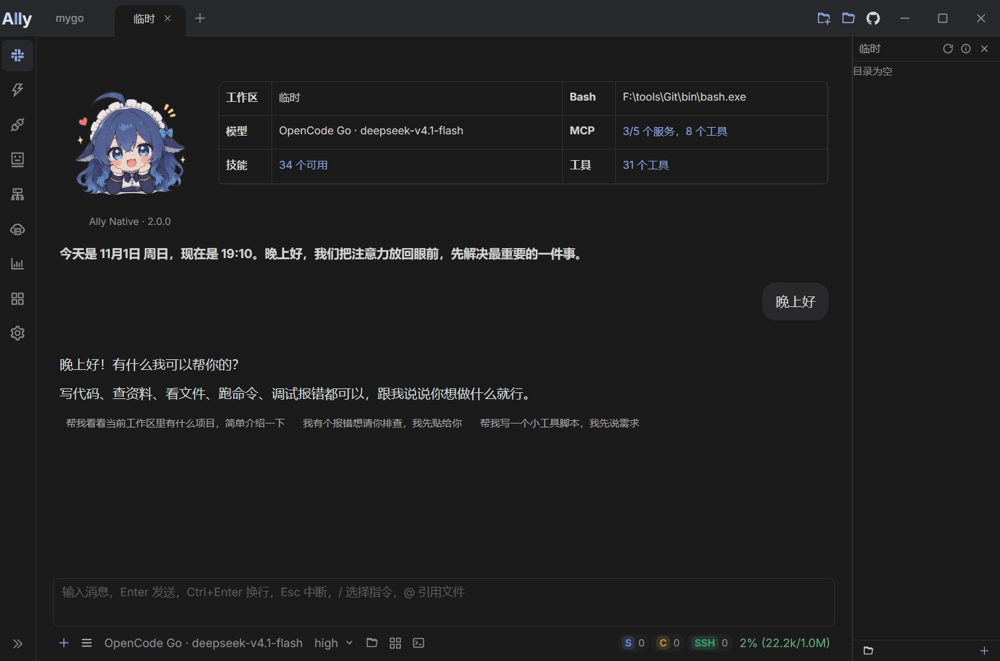
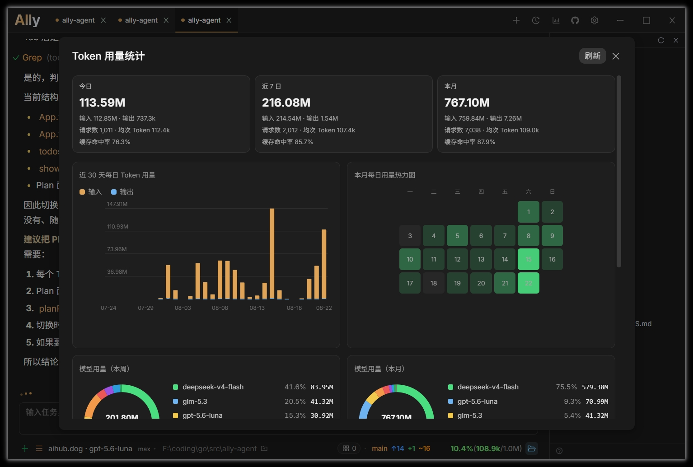
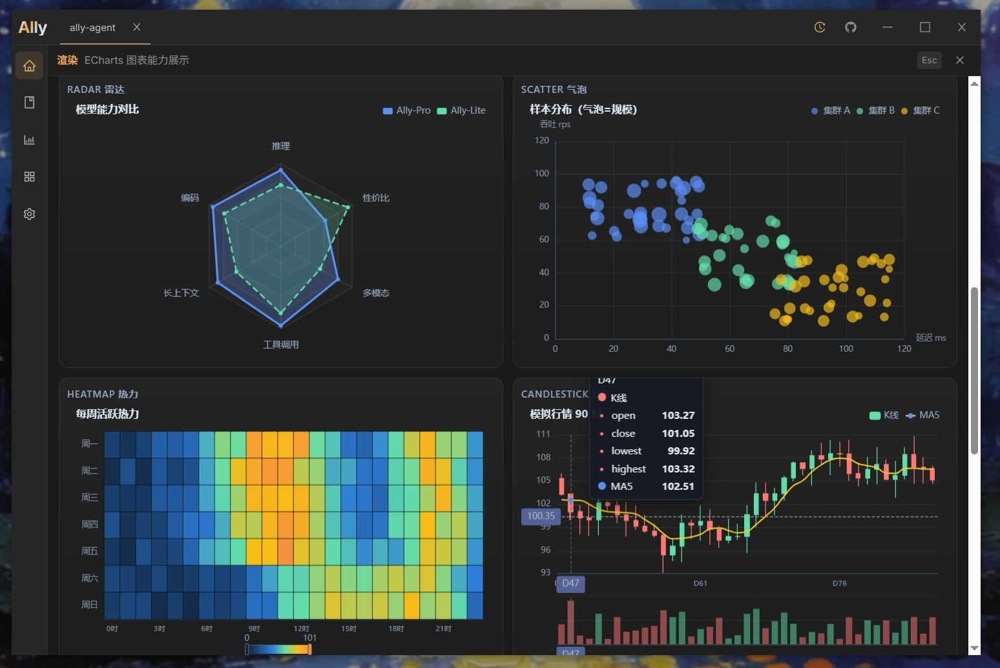
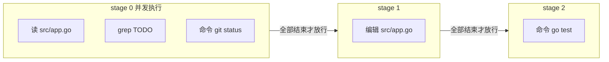

# Ally

Ally Native 是一款使用 Go 与 MyGo 绘制界面的桌面 AI 编程助手，**主打极低资源占用，为多任务并行与远程开发而生。** 你可以通过对话理解代码、编辑文件、搜索项目、管理任务并完成开发工作。

⭐ 如果 Ally 帮到了你，欢迎在 GitHub 点个 Star，这是对项目最大的支持，谢谢！

<p>
  <a href="https://github.com/Bronya0/ally-agent/releases">
    
  </a>
  <a href="https://awesomemygo.dev/apps/ally">
    
  </a>
</p>

前往 [Releases 页面](https://github.com/Bronya0/ally-agent/releases)下载 Windows、macOS 或 Linux 安装包。







## 主要功能

- 使用 Go 与 MyGo 绘制原生桌面界面，统一 Windows、macOS 和 Linux 上的主要交互与视觉样式
- 通过自然语言对话、附件和持久化会话处理本地项目
- 在工作区安全边界和版本校验保护下读取、搜索、创建、编辑及删除文件
- 通过 SSH 操作远程主机工作区：读取、编辑、创建、删除文件，执行命令，并在本地与远端之间传输文件或目录，复用本机已有的 `ssh` 登录配置
- 在聊天中直接查看可视化 Diff、多文件修改、命令输出和完整的工具失败原因
- 支持 OpenAI Chat Completions、OpenAI Responses、Anthropic Messages 及兼容模型服务
- 支持读取服务商推理字段，也可配置 `reasoning_content`、`think`、`sink` 等推理标签
- 工作区级模型选择，每个项目可独立配置使用的模型
- 可配置思考强度（reasoningEffort），按模型精细控制推理开销
- 支持配置多个 API Key，自动优先级故障转移与冷却恢复，保障可用性
- 内置服务商/模型预设目录，添加模型时自动填充 API 格式、地址与上下文窗口
- 支持在聊天中安全渲染沙箱 HTML，用于小工具、交互预览和组件展示
- 聊天中内联渲染 Mermaid 图表（滚轮缩放、拖拽平移、双击复位）与高亮代码块
- 可为支持视觉能力的模型附带图片输入，模型生成的图片直接在聊天中预览
- 可将复杂任务委派给并行子代理，实时查看步骤、工具活动、Token 用量和最终摘要
- 插件系统：一个 zip 包即可在侧栏新增一个整页，页面用纯 JS/TS 编写，HTTP、存储与工作区访问由清单声明
- MCP 支持 stdio、SSE 和 Streamable HTTP，可使用表单或原始 JSON 配置
- 使用可发现的 Skills 扩展工作流程，并通过全局记忆保存跨项目知识；内置技能含 `ally-agent`（Ally 使用手册）、`playwright-cli`、`anydoc`（Office/PDF 转 Markdown）、`md2other`（Markdown 转 Word/PDF，自带排版脚本）
- 管理多个工作区、聊天会话、Todo 和重启后继续运行的定时任务，内置原生文件浏览器与文件编辑器
- 支持短时命令和带任务中心日志查看的后台进程；Windows 会自动发现 Git Bash，必要时回退到 PowerShell
- 支持抓取网页与调用 HTTP API，带响应大小上限、超时、重定向限制与每主机限速
- 异步 Token 统计仪表盘，可视化用量趋势
- 自定义聊天背景图，可调节透明度
- 支持深色、浅色和自动主题，以及多种强调色；欢迎页提供多种内置形象与自定义图片
- 可在「设置 → 通用 → 外观」开启桌面宠物；拖动身体移动、点击头部互动，大小和位置会保存。右键菜单可摸头、主动聊天、查看好感度、调整大小、开关闲聊或关闭桌宠。宠物可显示任务完成耗时，闲时说话，并按形象分别积累好感度；闲聊是本地短句，不会自动调用模型。欢迎页和桌宠共用形象及动作，开启桌宠时欢迎页显示静态形象。
- Windows 与 macOS 自动升级（macOS 走 DMG 替换流程），失败时暂存目录自动回滚
- 可跟随 Windows 或 macOS 系统代理，或手动配置 HTTP/HTTPS/SOCKS5 代理，并统一应用到模型、HTTP 工具、MCP、命令和后台服务
- 提供中文和英文界面，包括启动警告、设置与工具状态信息
- 发行包已内置 ripgrep，无需单独安装即可搜索代码

## 开始使用

1. 从 [GitHub Releases](https://github.com/Bronya0/ally-agent/releases) 下载对应平台的软件包。
2. 启动 Ally 并选择一个项目目录。
3. 打开设置，配置模型服务、模型名称、API 地址和 API Key。
4. 开始与 Ally 对话。

Windows 发行包为 ZIP，解压后运行 `Ally.exe`。macOS 发行包为 DMG，将 `Ally.app` 拖入「应用程序」后打开。应用使用免费的 ad-hoc 签名且未做公证；如果首次打开时被系统拦截，确认下载来源可信后，在「系统设置 → 隐私与安全性」中选择「仍要打开」。Linux 提供 x64 和 ARM64 压缩包，当前需要手动下载和替换版本。

Ally Native 沿用原版的 `~/.ally_agent` 配置和会话数据。常用快捷键：Enter 发送，Ctrl+Enter 换行，Esc 中断当前会话或工具调用。

## 分阶段工具调用

模型可以在一次回复里发多个工具调用，每个调用可以带一个可选的段号（`stage`）。同一段内的调用并发执行。上一段的调用全部结束后才会进入下一段，包括仍在并发上限后排队的调用。任何一处真实失败都会让后续段停止执行，并把跳过原因返回给模型；已经完成的写入、安装和服务不会回滚。所以“先改代码，再跑测试，最后校验”这类有先后的任务，用段号表达就够了，不必拆成多轮对话。

段号只排先后，不传值。依赖上一步返回结果的参数（比如文件版本号）仍然需要分轮发起。



## 插件系统

插件就是一个 zip 包，装进来后侧栏会多出一个整页。页面用纯 JavaScript/TypeScript 编写，不用写 Go、不用打包、不用重启应用。页面通过 Ally 注入的 `host` 对象使用后端能力，包括 HTTP、插件私有存储、工作区只读访问、事件和主题。

在**插件**页管理插件：导入 zip（也可以直接拖进来）、从已展开的目录安装、导出（可选是否包含插件数据）、启用或禁用、删除。

一个最小的 `plugin.json`：

```json
{
  "id": "my-helper",
  "name": "工单助手",
  "version": "1.0.0",
  "entry": "index.js",
  "menu": [{ "key": "helper", "title": "工单", "icon": "ApiOutlined" }],
  "permissions": { "http": ["api.example.com"], "workspace": "read" }
}
```

入口模块导出 `mount(element, host)`，返回值是卸载函数。

- 清单只认文档列出的键，写了未知键会在导入时报错。
- 未在 `permissions.http` 中声明的主机，HTTP 请求一律拒绝。
- 用相同 `id` 重新导入即为覆盖升级，`host.store` 中的数据会保留。
- 插件代码运行在主页面上下文中，不是沙箱：它可以直接调用后端绑定，安装时也不会弹出权限确认。请只安装你信任的插件。
- 插件页以及 HTML、Mermaid 内容预览按需使用受控 WebView；主界面与常规页面仍由 Go 和 MyGo 原生绘制。

完整说明（`host` API、样式规范与常见坑）见 [docs/plugin-system.md](docs/plugin-system.md)。也可以把这个链接发给 AI 助手，让它帮你写插件。

## 本地构建

需要 Go 1.27.3 和 Python 3.9+。Windows 与 macOS 开发构建可以直接使用以下入口：

| 系统 | 入口 | 产物 |
| --- | --- | --- |
| Windows | `scripts/build.bat` | `dist/ally-native.exe` 与 `dist/tools/rg.exe` |
| macOS | `scripts/build.command` | 当前机器架构的 `dist/Ally.app` |

也可以从命令行运行：

```bash
go run .
python scripts/build.py dev
```

全平台发行构建仅在 macOS 上执行，需显式指定稳定版标签：

```bash
BUILD_TAG=v2.1.0 bash scripts/build-all.sh
```

构建会生成 Windows x64/ARM64、macOS Universal/Intel/Apple Silicon 和 Linux x64/ARM64 共七个发行包。更多构建与架构说明见 [升级兼容文档](docs/update-compatibility.md)。

## 许可证

Copyright (C) 2026 Bronya0。

Ally 是采用 [GNU General Public License v3.0 only](LICENSE)（`GPL-3.0-only`）发布的自由软件。你可以依照该许可证使用、研究、修改和重新分发本项目。分发 Ally 或其修改版本时，必须提供对应源代码并保留 GPLv3 许可证声明。

发行包包含采用自身 MIT/Unlicense 条款的 [ripgrep](https://github.com/BurntSushi/ripgrep)。其他第三方资源保留各自的许可证，详见 [THIRD_PARTY_NOTICES.md](THIRD_PARTY_NOTICES.md)。

## 联系方式

问题反馈、建议或合作请联系：[tangssst@qq.com](mailto:tangssst@qq.com)

## 参考项目

Ally 在部分实现细节上参考了下列项目与工程文章的做法，在此致谢。各项目遵循其自身许可证，Ally 与它们没有隶属关系。

- [Anthropic — Building Effective Agents](https://www.anthropic.com/engineering/building-effective-agents)
- [DeepSeek Harness](https://github.com/deepseek-ai/deepseek-harness)
- [Anthropic — Managed Agents](https://www.anthropic.com/engineering/managed-agents)
- [Kimi Code CLI（kimicode）](https://github.com/MoonshotAI/kimi-code) — 亮色主题色板、图片 token 估算、中断提醒等交互与计量细节
- [Codex CLI](https://github.com/openai/codex) — Responses 协议的会话缓存键与用量字段处理
- [pi](https://github.com/earendil-works/pi) — 编辑模糊匹配、上下文估算、思考档位能力判定、溢出恢复压缩
- [OpenCode](https://github.com/sst/opencode) — 请求头与 User-Agent 等兼容性约定
