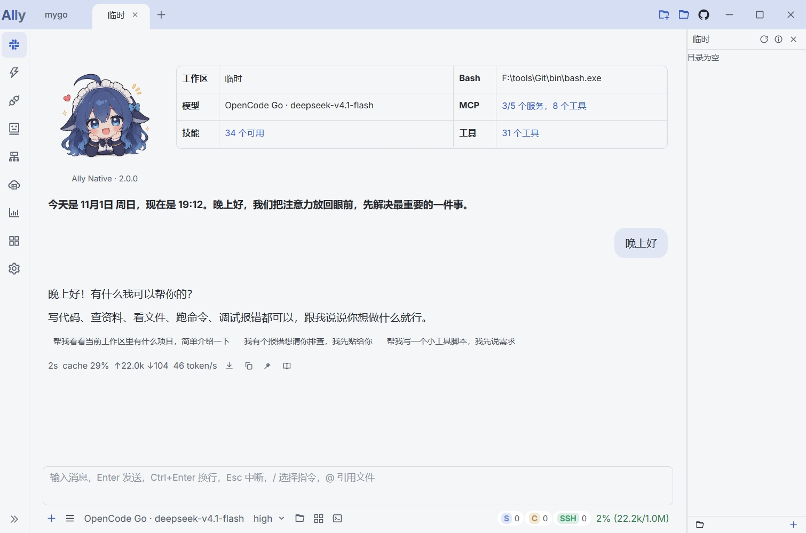
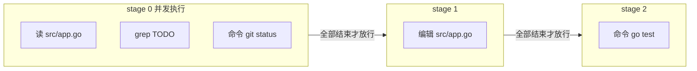

# Ally Native

Ally Native 是一款轻量的原生桌面 AI 编程助手，使用 Go 与 [MyGo](https://github.com/egoist/mygo) 构建，支持 Windows、macOS 和 Linux。通过对话理解项目、修改代码、运行命令，也可以授权 SSH 节点，把工作交给远程主机。

**极低资源占用、多工作区并行开发、并行子代理、可选模型服务，还有一只陪你写代码的大肥鱼。**

<p align="center">
  
</p>

<p align="center">
  大肥鱼 · 欢迎页与桌宠形象<br>
  <sub>社区同人素材，来源于 <a href="https://github.com/Small-tailqwq/dsh-deep-whale">dsh-deep-whale</a>，采用 CC BY-NC-SA 4.0；<a href="resources/avatar/whale/README.md">作者署名与素材说明</a>。</sub>
</p>

⭐ 如果 Ally 帮到了你，欢迎在 GitHub 点个 Star，这是对项目最大的支持，谢谢！

<p>
  <a href="https://github.com/Bronya0/ally-agent/releases">
    
  </a>
  <a href="https://awesomemygo.dev/apps/ally">
    
  </a>
</p>

前往 [Releases 页面](https://github.com/Bronya0/ally-agent/releases)下载 Windows、macOS 或 Linux 安装包。




## 主要功能

### 本地编程与远程开发

- 读取、搜索、创建、编辑及删除项目文件，写入受工作区边界和文件版本校验保护；发行包内置 ripgrep，无需额外安装。
- 在聊天中查看可视化 Diff、多文件修改、命令输出与工具失败原因，配合原生文件浏览器和编辑器处理项目。
- 授权 SSH 节点后，读写远程文件、执行命令，并在本机与远端之间传输文件或目录；支持本机免密、私钥和密码认证。
- 同时管理多个工作区和聊天会话，将复杂任务交给并行子代理，实时查看步骤、工具活动、Token 用量与结果。
- 支持短时命令与后台进程，在任务中心查看日志；Windows 自动发现 Git Bash，必要时回退到 PowerShell。

### 模型与对话

- 支持 OpenAI Chat Completions、OpenAI Responses、Anthropic Messages 及兼容服务，也可通过 ChatGPT 登录接入已授权账号的模型。
- 每个工作区独立选择模型；内置服务商与模型预设，可配置思考强度、输出上限、上下文窗口和自定义请求头。
- 支持多个 API Key，按优先级故障转移与冷却恢复；展示服务商推理字段，也可配置 `reasoning_content`、`think`、`sink` 等推理标签。
- 支持附件与视觉模型的图片输入，生成的图片可在聊天中预览；Windows 支持配置语音转写模型，按住快捷键说话后填入输入框。
- 保存聊天历史，通过全文总结或本地裁剪压缩长会话上下文；Token 统计仪表盘展示用量趋势。

### 工具与扩展

- MCP 支持 stdio、SSE 和 Streamable HTTP，可通过表单或原始 JSON 配置，并选择向新会话开放的工具。
- 自动发现工作区与用户目录下的 Skills，按需加载技能和引用文件；通过全局记忆保存跨项目知识。内置 `ally-agent`、`playwright-cli`、`anydoc`、`md2other` 等技能。
- 支持网页抓取与 HTTP API 调用，带响应大小上限、超时、重定向限制和每主机限速。
- 在聊天中预览沙箱 HTML、Mermaid 图表和高亮代码块；图表支持滚轮缩放、拖拽平移与双击复位。
- 导入一个 zip 即可安装 JS/TS 插件，在侧栏添加工具页面；通过公开宿主 API 使用 HTTP、存储和工作区访问能力。
- 提供[本地 HTTP API](docs/api.md)，供插件、脚本、IDE 与自动化工具调用；管理 Todo 和持久化定时任务，重启后继续调度。

### 原生桌面体验

- 主界面与常规页面由 Go 和 [MyGo](https://github.com/egoist/mygo) 原生绘制；插件与 HTML、Mermaid、媒体预览按需使用受控 WebView。
- 支持深色、浅色和按本地时间自动切换的主题，多种强调色、阅读字号和可调透明度的聊天背景图。
- 欢迎页与桌宠提供大肥鱼、小机器人等内置形象，也可上传自己的图片。
- Windows 与 macOS 支持自动下载更新并提示重启，Linux 提供版本检测与手动更新。
- 可跟随 Windows 或 macOS 系统代理，也可手动配置 HTTP/HTTPS/SOCKS5 代理，统一应用到模型、HTTP 工具、MCP、命令和后台服务。
- 提供中文和英文界面。

## 开始使用

1. 从 [GitHub Releases](https://github.com/Bronya0/ally-agent/releases) 下载对应平台的软件包。
2. 启动 Ally 并选择一个项目目录。
3. 打开「模型」页，添加模型服务，填写模型名称、API 地址和 API Key，或选择 ChatGPT 登录。
4. 在聊天输入框下方选择模型，发送你的任务。需要远程开发时，先添加 SSH 节点，再在当前工作区勾选授权。

Windows 发行包为 ZIP，解压后运行 `Ally.exe`。macOS 发行包为 DMG，将 `Ally.app` 拖入「应用程序」后打开。应用使用免费的 ad-hoc 签名且未做公证；如果首次打开时被系统拦截，确认下载来源可信后，在「系统设置 → 隐私与安全性」中选择「仍要打开」。Linux 提供 x64 和 ARM64 压缩包，当前需要手动下载和替换版本。

Ally Native 沿用原版的 `~/.ally_agent` 配置和会话数据。常用快捷键：Enter 发送，Ctrl+Enter 换行，Esc 中断当前会话或工具调用。

## 大肥鱼陪你写代码

新用户默认使用大肥鱼形象并开启桌宠。可以在「设置 → 通用 → 外观」切换形象、调整桌宠或关闭它。

- 拖动身体移动，点击头部互动；大小和位置会保存。
- 右键菜单支持摸头、主动聊天、查看好感度、调整大小和开关闲聊。
- 工作时显示对应动作，任务完成后提示耗时；摸头与完成任务会积累好感度，各形象分别记录。
- 闲聊使用本地短句，不会自动调用模型。欢迎页和桌宠共用形象；开启桌宠时，欢迎页显示静态形象。

## 分阶段工具调用

模型可以在一次回复里发多个工具调用，每个调用可以带一个可选的段号（`stage`）。同一段内的调用并发执行。上一段的调用全部结束后才会进入下一段，包括仍在并发上限后排队的调用。任何一处真实失败都会让后续段停止执行，并把跳过原因返回给模型；已经完成的写入、安装和服务不会回滚。所以“先改代码，再跑测试，最后校验”这类有先后的任务，用段号表达就够了，不必拆成多轮对话。

段号只排先后，不传值。依赖上一步返回结果的参数（比如文件版本号）仍然需要分轮发起。



## 插件系统

插件是一个包含清单与页面源码的 zip 包，安装后在侧栏新增页面。使用 JavaScript/TypeScript 编写，不需要编译 Ally 或重启应用；页面通过宿主提供的 `host` 使用 HTTP、插件私有存储、工作区只读访问、事件和主题，AI 与会话能力统一调用[本地 HTTP API](docs/api.md)。

在**插件**页管理插件：导入 zip（也可以直接拖进来）、从已展开的目录安装、导出（可选是否包含插件数据）、启用或禁用、删除。

一个最小的 `plugin.json`：

```json
{
  "id": "my-helper",
  "name": "工单助手",
  "version": "1.0.0",
  "entry": "index.js",
  "menu": [{ "key": "helper", "title": "工单", "icon": "ApiOutlined" }],
  "permissions": { "http": ["api.example.com"], "workspace": "read" }
}
```

入口模块导出 `mount(element, host)`，返回值是卸载函数。

- 清单只认文档列出的键，写了未知键会在导入时报错。
- 未在 `permissions.http` 中声明的主机，HTTP 请求一律拒绝。
- 用相同 `id` 重新导入即为覆盖升级，`host.store` 中的数据会保留。
- 插件页面使用独立的 WebView，通过公开宿主 API 接入能力，不注入旧版 Wails 绑定。请只安装你信任的插件。
- 页面按首次访问创建，最多缓存 3 个插件 WebView；被回收后再次进入会重新加载，插件应及时保存重要数据。

完整说明（`host` API、样式规范与常见坑）见 [docs/plugin-system.md](docs/plugin-system.md)。也可以把这个链接发给 AI 助手，让它帮你写插件。

## 本地构建

需要 Go 1.27.3 和 Python 3.9+，原生 UI 使用 [MyGo](https://github.com/egoist/mygo)。Windows 与 macOS 开发构建可以直接使用以下入口：

| 系统 | 入口 | 产物 |
| --- | --- | --- |
| Windows | `scripts/build.bat` | `dist/ally-native.exe` 与 `dist/tools/rg.exe` |
| macOS | `scripts/build.command` | 当前机器架构的 `dist/Ally.app` |

也可以从命令行运行：

```bash
go run .
python scripts/build.py dev
```

全平台发行构建仅在 macOS 上执行，需显式指定稳定版标签：

```bash
BUILD_TAG=v2.1.0 bash scripts/build-all.sh
```

构建会生成 Windows x64/ARM64、macOS Universal/Intel/Apple Silicon 和 Linux x64/ARM64 共七个发行包。更多构建与架构说明见 [升级兼容文档](docs/update-compatibility.md)。

## 许可证

Copyright (C) 2026 Bronya0。

Ally 是采用 [GNU General Public License v3.0 only](LICENSE)（`GPL-3.0-only`）发布的自由软件。你可以依照该许可证使用、研究、修改和重新分发本项目。分发 Ally 或其修改版本时，必须提供对应源代码并保留 GPLv3 许可证声明。

发行包包含采用自身 MIT/Unlicense 条款的 [ripgrep](https://github.com/BurntSushi/ripgrep)。其他第三方资源保留各自的许可证，详见 [THIRD_PARTY_NOTICES.md](THIRD_PARTY_NOTICES.md)。

## 联系方式

问题反馈、建议或合作请联系：[tangssst@qq.com](mailto:tangssst@qq.com)

## 参考项目

Ally 在部分实现细节上参考了下列项目与工程文章的做法，在此致谢。各项目遵循其自身许可证，Ally 与它们没有隶属关系。

- [Anthropic — Building Effective Agents](https://www.anthropic.com/engineering/building-effective-agents)
- [DeepSeek Harness](https://github.com/deepseek-ai/deepseek-harness)
- [Anthropic — Managed Agents](https://www.anthropic.com/engineering/managed-agents)
- [Kimi Code CLI（kimicode）](https://github.com/MoonshotAI/kimi-code) — 亮色主题色板、图片 token 估算、中断提醒等交互与计量细节
- [Codex CLI](https://github.com/openai/codex) — Responses 协议的会话缓存键与用量字段处理
- [pi](https://github.com/earendil-works/pi) — 编辑模糊匹配、上下文估算、思考档位能力判定、溢出恢复压缩
- [OpenCode](https://github.com/sst/opencode) — 请求头与 User-Agent 等兼容性约定
