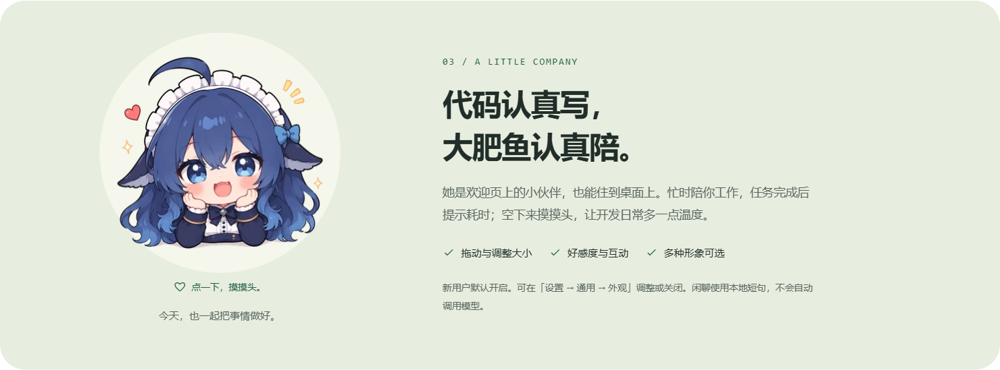
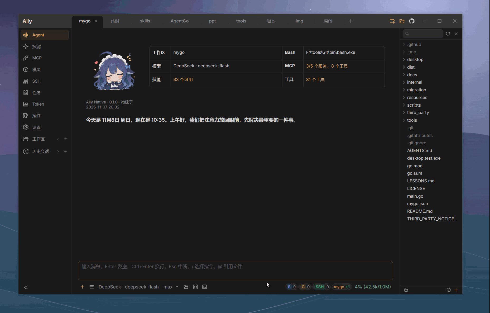
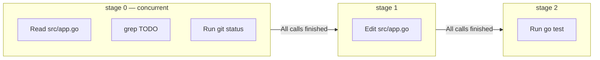

[简体中文](README.zh-CN.md) · [English](README.en.md) · [日本語](README.ja.md) · [한국어](README.ko.md)

# Ally Agent

Ally Agent is a lightweight native desktop AI coding assistant built with Go and [MyGo](https://github.com/egoist/mygo), for Windows, macOS and Linux. Ask it to understand a project, edit code and run commands, or authorize an SSH node to work on a remote host.

**Low resource usage, parallel workspaces and subagents, your choice of model providers, and a Big Whale to keep you company while you code.**

⭐ If Ally helps you, a Star on GitHub is a great way to support the project. Thank you!

<p>
  <a href="https://github.com/Bronya0/ally-agent/releases">
    
  </a>
  <a href="https://awesomemygo.dev/apps/ally">
    
  </a>
</p>

Download a Windows, macOS or Linux package from [GitHub Releases](https://github.com/Bronya0/ally-agent/releases).





## Features

### Local coding and remote development

- Read, search, create, edit and delete project files. Workspace boundaries and file version checks protect writes. Packages include ripgrep, so no separate installation is needed.
- Inspect visual diffs, changes across files, command output and tool errors in chat, alongside a native file explorer and editor.
- Authorize SSH nodes to read and write remote files, run commands and transfer files or directories. Authentication supports local SSH configuration/Agent, private keys and passwords.
- Manage multiple workspaces and chat sessions, delegate complex tasks to parallel subagents, and follow steps, tool activity, Token usage and results in real time.
- Run short commands and background processes, with logs in the task center. Windows detects Git Bash automatically and falls back to PowerShell when needed.

### Models and conversations

- OpenAI Chat Completions, OpenAI Responses, Anthropic Messages and compatible services, plus ChatGPT login for models available to your authorized account.
- Choose models independently per workspace. Provider and model presets include configurable reasoning effort, output limits, context windows and custom request headers.
- Multiple API Keys with priority-based failover and recovery after cooldown. View provider reasoning fields or configure tags such as `reasoning_content`, `think` and `sink`.
- Attach images for vision models and preview generated images in chat. On Windows, configure a speech transcription model and hold a shortcut to dictate into the composer.
- Save chat history and compact long conversations using a model-generated summary or local trimming. Track usage trends in the Token dashboard.

### Tools and extensions

- MCP over stdio, SSE and Streamable HTTP. Configure servers using forms or raw JSON, and choose which tools are available to new sessions.
- Automatically discover Skills in workspace and user directories, loading content and reference files on demand. Global memory retains knowledge across projects. Bundled skills include `ally-agent`, `playwright-cli`, `anydoc` and `md2other`.
- Fetch web pages and call HTTP APIs with response size caps, timeouts, redirect limits and per-host rate limits.
- Preview sandboxed HTML, Mermaid diagrams and highlighted code blocks in chat. Diagrams support wheel zoom, dragging and double-click reset.
- Install JS/TS plugins from ZIP packages to add sidebar pages, with HTTP, storage and workspace access through the public host API.
- A [local HTTP API](api.md) for plugins, scripts, IDEs and automation. Manage Todo lists and persistent scheduled tasks that resume scheduling after restart.

### Native desktop experience

- Go and [MyGo](https://github.com/egoist/mygo) draw the main UI and regular pages natively. Plugins and HTML, Mermaid and media previews use controlled WebViews on demand.
- Dark, light and time-based automatic appearance, with several palettes. The Qinghe light theme matches the website's pale gray-green background, paper-white cards and dark green accents. Adjust reading font sizes and chat background opacity.
- Built-in welcome avatars and desktop pets, including Big Whale and a small robot, with support for custom images.
- Automatic update downloads and restart prompts on Windows and macOS; version checks and manual updates on Linux.
- Use the Windows or macOS system proxy, or configure HTTP/HTTPS/SOCKS5 manually. Proxy settings apply to models, HTTP tools, MCP, commands and background services.
- English, Simplified Chinese, Japanese and Korean UI. The default follows the system language, falls back to English, and can be changed instantly in Settings.

## Getting started

1. Download the package for your platform from [GitHub Releases](https://github.com/Bronya0/ally-agent/releases).
2. Launch Ally and choose a project directory.
3. Open **Models**, add a provider and enter the model name, API URL and API Key, or sign in with ChatGPT.
4. Select a model below the chat composer and send your task. For remote development, add an SSH node and authorize it in the current workspace.

On Windows, extract the ZIP and run `Ally.exe`. On macOS, open the DMG and drag `Ally.app` into Applications. The app uses ad-hoc signing and is not notarized; if macOS blocks the first launch, verify the download source and choose **Open Anyway** in **System Settings → Privacy & Security**. Linux packages are available for x64 and ARM64 and currently require manual downloads and replacement.

Ally Agent retains the original `~/.ally_agent` configuration and session data. Shortcuts: Enter to send, Ctrl+Enter for a new line, Esc to interrupt the current session or tool call.

## Code with Big Whale

New users start with Big Whale and the desktop pet enabled. Change the avatar, adjust the pet or disable it in **Settings → General → Appearance**.

- Drag the body to move it and click its head to interact. Size and position are saved.
- Right-click to pet its head, start a chat, view affection, change its size or toggle chatter.
- Animations reflect ongoing work, and completed tasks show elapsed time. Petting and completed tasks build affection, tracked separately for each avatar.
- Chatter uses local phrases without automatically calling a model. The welcome page shares the avatar and shows a static image while the desktop pet is enabled.

## Staged tool calls

A model can issue several tool calls in one reply, each with an optional `stage` number. Calls within a stage run concurrently. The next stage starts only after every call in the previous stage finishes, including calls queued behind the concurrency limit. A failure stops later stages and reports why they were skipped; completed writes, installations and services are not rolled back. This lets the model express ordered work such as “edit, test, then verify” in one reply.

Stages order execution; they do not pass values between calls. Parameters that depend on earlier results, such as file version numbers, still require separate rounds.



## Plugins

A plugin is a ZIP containing a manifest and page source. Install it to add a sidebar page. Write plugins in JavaScript/TypeScript without rebuilding Ally or restarting it. The `host` API offers HTTP, private plugin storage, read-only workspace access, events and themes. Use the [local HTTP API](api.md) for AI and session capabilities.

On the **Plugins** page, import or drag in a ZIP, install from an extracted directory, export with optional plugin data, enable, disable or delete.

A minimal `plugin.json`:

```json
{
  "id": "my-helper",
  "name": "Ticket helper",
  "version": "1.0.0",
  "entry": "index.js",
  "menu": [{ "key": "helper", "title": "Tickets", "icon": "ApiOutlined" }],
  "permissions": { "http": ["api.example.com"], "workspace": "read" }
}
```

The entry module exports `mount(element, host)` and returns a cleanup function.

- Unknown manifest keys are rejected during import.
- HTTP requests to hosts absent from `permissions.http` are rejected.
- Importing the same `id` replaces the plugin while preserving `host.store` data.
- Plugin pages use independent WebViews and the public host API, without legacy Wails bindings. Install plugins you trust.
- Pages are created on first access, with at most three plugin WebViews cached. Evicted pages reload on the next visit, so plugins should save important state promptly.

See [plugin-system.md](plugin-system.md) for the `host` API, styling and common pitfalls. You can also give that document to an AI assistant to help write a plugin.

## Building locally

Requires Go 1.27.3 and Python 3.9+. The native UI uses [MyGo](https://github.com/egoist/mygo).

| Platform | Script | Output |
| --- | --- | --- |
| Windows | `scripts/build.bat` | `dist/ally-native.exe` and `dist/tools/rg.exe` |
| macOS | `scripts/build.command` | `dist/Ally.app` for the current architecture |

From the repository root:

```bash
go run .
python scripts/build.py dev
```

Build all release platforms on macOS with an explicit stable version tag:

```bash
BUILD_TAG=v2.1.0 bash scripts/build-all.sh
```

This produces seven packages: Windows x64/ARM64, macOS Universal/Intel/Apple Silicon and Linux x64/ARM64. See [update-compatibility.md](update-compatibility.md) for details.

## License

Copyright (C) 2026 Bronya0.

Ally is free software under the [GNU General Public License v3.0 only](../LICENSE) (`GPL-3.0-only`). You may use, study, modify and redistribute it under that license. Distributions of Ally or modified versions must include corresponding source code and retain the GPLv3 notices.

Packages include [ripgrep](https://github.com/BurntSushi/ripgrep) under its MIT/Unlicense terms. Other third-party resources retain their own licenses; see [THIRD_PARTY_NOTICES.md](../THIRD_PARTY_NOTICES.md).

## Contact

For feedback, suggestions or collaboration: [tangssst@qq.com](mailto:tangssst@qq.com).

## References

Some implementation details draw on these projects and engineering articles. Each has its own license; Ally is independent of these projects.

- [Anthropic — Building Effective Agents](https://www.anthropic.com/engineering/building-effective-agents)
- [DeepSeek Harness](https://github.com/deepseek-ai/deepseek-harness)
- [Anthropic — Managed Agents](https://www.anthropic.com/engineering/managed-agents)
- [Kimi Code CLI (kimicode)](https://github.com/MoonshotAI/kimi-code) — light palettes, image Token estimates and interruption reminders
- [Codex CLI](https://github.com/openai/codex) — Responses session cache keys and usage fields
- [pi](https://github.com/earendil-works/pi) — fuzzy editing, context estimates, reasoning levels and overflow recovery
- [OpenCode](https://github.com/sst/opencode) — request header and User-Agent compatibility

<sub>Big Whale community artwork comes from <a href="https://github.com/Small-tailqwq/dsh-deep-whale">dsh-deep-whale</a> under CC BY-NC-SA 4.0. See <a href="../resources/avatar/whale/README.md">credits and asset details</a>.</sub>
