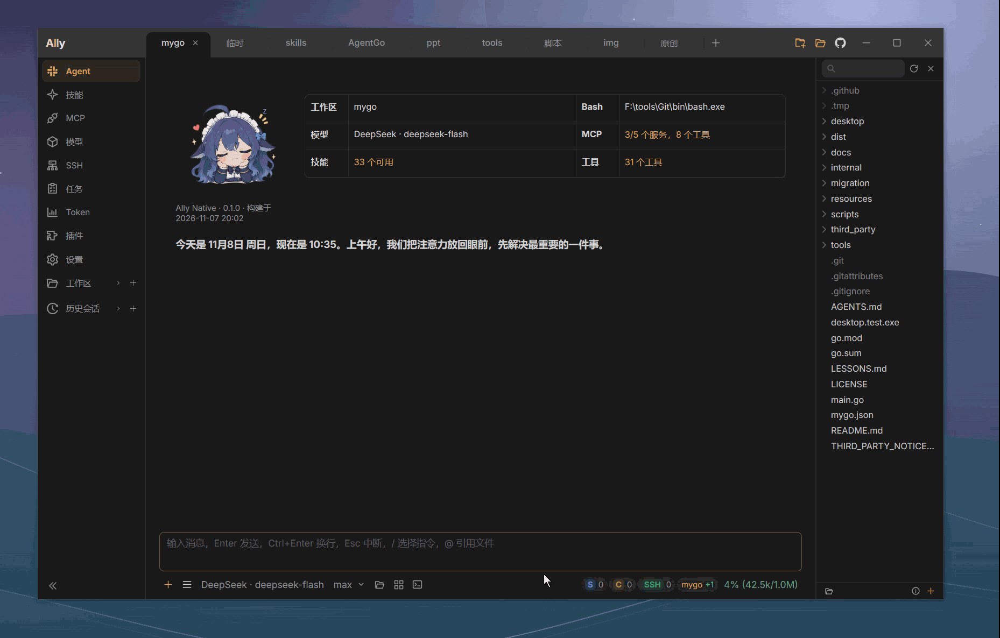
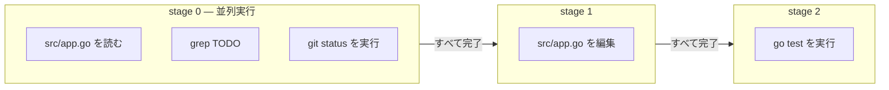

[简体中文](README.zh-CN.md) · [English](README.en.md) · [日本語](README.ja.md) · [한국어](README.ko.md)

# Ally Agent

Ally Agent は、Go と [MyGo](https://github.com/egoist/mygo) で作られた軽量なネイティブデスクトップ AI コーディングアシスタントです。Windows、macOS、Linux に対応しています。対話を通じてプロジェクトを理解し、コードを編集し、コマンドを実行します。SSH ノードを許可すれば、リモートホストでの作業も任せられます。

**少ないリソースで動作し、複数のワークスペースとサブエージェントで並行作業。ヘッドレス実行とローカル HTTP API、モデルの提供元を自由に選べて、大きなクジラがコーディングのお供をします。**

⭐ Ally が役に立ったら、GitHub で Star を付けて応援していただけるとうれしいです！

<p>
  <a href="https://github.com/Bronya0/ally-agent/releases">
    
  </a>
  <a href="https://awesomemygo.dev/apps/ally">
    
  </a>
</p>

[GitHub Releases](https://github.com/Bronya0/ally-agent/releases) から Windows、macOS、Linux 向けパッケージをダウンロードできます。



## 主な機能

### ローカル開発とリモート開発

- プロジェクトファイルの読み取り、検索、作成、編集、削除。書き込みにはワークスペース境界とファイルバージョンの検証を適用します。配布パッケージに ripgrep を同梱しているため、別途インストールする必要はありません。
- チャット内で差分、複数ファイルの変更、コマンド出力、ツールのエラーを確認。ネイティブのファイルエクスプローラーとエディターも利用できます。
- 許可した SSH ノードでファイルの読み書きとコマンド実行が可能。ローカルとの間でファイルやディレクトリを転送できます。ローカルの SSH 設定・Agent、秘密鍵、パスワード認証に対応します。
- 複数のワークスペースと会話を管理し、複雑な作業を並列サブエージェントに委任。手順、ツールの動作、Token 使用量、結果をリアルタイムに確認できます。
- 短時間のコマンドとバックグラウンドプロセスに対応し、タスクセンターでログを表示。Windows では Git Bash を自動検出し、必要に応じて PowerShell を使用します。

### モデルと会話

- OpenAI Chat Completions、OpenAI Responses、Anthropic Messages と互換サービスに対応。ChatGPT にログインして、アカウントで利用できるモデルにも接続できます。
- ワークスペースごとにモデルを選択。プロバイダーとモデルのプリセットに加え、推論の深さ、出力上限、コンテキストウィンドウ、カスタムリクエストヘッダーを設定できます。
- 複数の API Key を優先順に切り替え、障害後はクールダウンを経て復帰。プロバイダーの推論フィールドを表示し、`reasoning_content`、`think`、`sink` などのタグも設定できます。
- 画像を添付して視覚対応モデルに送信し、生成画像をチャットでプレビュー。Windows では音声文字起こしモデルを設定し、ショートカットを押しながら話した内容を入力欄に反映できます。
- 会話履歴を保存し、モデルによる要約またはローカルでの切り詰めで長いコンテキストを圧縮。Token ダッシュボードで使用量の推移を確認できます。

### ツールと拡張機能

- MCP の stdio、SSE、Streamable HTTP に対応。フォームや JSON で設定し、新しい会話に公開するツールを選べます。
- ワークスペースとユーザーディレクトリの Skills を自動検出し、本文や参照ファイルを必要なときに読み込みます。グローバルメモリでプロジェクト間の知識を保存。`ally-agent`、`playwright-cli`、`anydoc`、`md2other` などを同梱しています。
- Web ページの取得と HTTP API 呼び出し。応答サイズ、タイムアウト、リダイレクト、ホストごとの頻度に上限を設けます。
- チャットでサンドボックス HTML、Mermaid 図、シンタックスハイライト付きコードをプレビュー。図はホイールで拡大縮小、ドラッグで移動、ダブルクリックでリセットできます。
- ZIP から JS/TS プラグインをインストールしてサイドバーにページを追加。公開ホスト API で HTTP、ストレージ、ワークスペースアクセスを利用できます。
- プラグイン、スクリプト、IDE、自動化向けの [ローカル HTTP API](api.md)。Todo と永続化された定期タスクを管理し、再起動後もスケジュールを継続します。

### ネイティブデスクトップ

- メイン UI と通常のページを Go と [MyGo](https://github.com/egoist/mygo) でネイティブ描画。プラグインや HTML、Mermaid、メディアのプレビューは、必要なときだけ管理された WebView を利用します。
- ダーク、ライト、ローカル時刻による自動切り替えと複数の配色に対応。文字サイズやチャット背景の不透明度も調整できます。
- 大きなクジラや小さなロボットなどのアバターとデスクトップペット。自分の画像も使用できます。
- Windows と macOS は更新の自動ダウンロードと再起動案内に対応。Linux はバージョン確認と手動更新に対応します。
- Windows・macOS のシステムプロキシ、または手動の HTTP/HTTPS/SOCKS5 設定を利用。モデル、HTTP ツール、MCP、コマンド、バックグラウンドサービスに共通で適用します。
- 簡体字中国語、英語、日本語、韓国語の UI。標準ではシステム言語を選び、対応言語がなければ英語を使用します。設定からすぐに切り替えられます。

## はじめに

1. [GitHub Releases](https://github.com/Bronya0/ally-agent/releases) からプラットフォームに合うパッケージをダウンロードします。
2. Ally を起動してプロジェクトディレクトリを選択します。
3. **モデル**ページで提供元を追加し、モデル名、API URL、API Key を入力するか、ChatGPT にログインします。
4. チャット入力欄の下でモデルを選び、作業を依頼します。リモート開発では SSH ノードを追加し、現在のワークスペースで利用を許可してください。

Windows は ZIP を展開して `Ally.exe` を実行します。macOS は DMG を開き、`Ally.app` を「アプリケーション」にドラッグします。アプリは ad-hoc 署名を使用し、公証されていません。初回起動をブロックされた場合は、配布元を確認して「システム設定 → プライバシーとセキュリティ」から「このまま開く」を選びます。Linux は x64 と ARM64 の圧縮パッケージを提供し、現在は手動でダウンロード・置換します。

既存の `~/.ally_agent` 設定と会話データを引き継ぎます。Enter で送信、Ctrl+Enter で改行、Esc で現在の会話やツール呼び出しを中断します。

## 大きなクジラとコーディング

初期設定では大きなクジラのデスクトップペットが有効です。**設定 → 一般 → 外観**でアバターを変更し、ペットを調整・無効化できます。

- 体をドラッグして移動し、頭をクリックして触れ合います。サイズと位置は保存されます。
- 右クリックで頭をなでる、話しかける、好感度を見る、サイズを変える、ひとりごとを切り替える操作ができます。
- 作業に合わせて動き、完了時には所要時間を表示。なでる操作とタスク完了で好感度が増え、アバターごとに記録します。
- ひとりごとはローカルの短いフレーズを使い、モデルを自動で呼び出しません。ウェルカム画面は同じアバターを使い、ペットが有効な間は静止画を表示します。

## 段階的なツール呼び出し

モデルは一度の応答で複数のツールを呼び出し、任意の `stage` 番号を指定できます。同じ段階は並列実行し、並列数の上限で待機中のものも含め、すべて完了してから次へ進みます。失敗があれば後続の段階を停止し、スキップ理由をモデルに返します。完了済みの書き込み、インストール、サービスは巻き戻しません。「編集 → テスト → 検証」の順序を、一度の応答で表現できます。

段階番号は順序を指定するだけで、値を受け渡しません。前の結果に依存する引数（ファイルバージョンなど）は、別のラウンドで送信する必要があります。



## プラグイン

プラグインはマニフェストとページのソースを含む ZIP です。JavaScript/TypeScript で作成でき、Ally の再ビルドや再起動は不要です。`host` API で HTTP、プライベートストレージ、ワークスペースの読み取り、イベント、テーマを利用し、AI と会話の機能は [ローカル HTTP API](api.md) で呼び出します。

**プラグイン**ページで ZIP の取り込み・ドラッグ、展開済みディレクトリからのインストール、データを含めるか選べるエクスポート、有効化、無効化、削除ができます。

最小限の `plugin.json`:

```json
{
  "id": "my-helper",
  "name": "チケットアシスタント",
  "version": "1.0.0",
  "entry": "index.js",
  "menu": [{ "key": "helper", "title": "チケット", "icon": "ApiOutlined" }],
  "permissions": { "http": ["api.example.com"], "workspace": "read" }
}
```

エントリーモジュールは `mount(element, host)` をエクスポートし、終了処理の関数を返します。

- 未定義のマニフェストキーは取り込み時に拒否します。
- `permissions.http` にないホストへの HTTP 要求は拒否します。
- 同じ `id` で再取り込みすると上書き更新し、`host.store` のデータは保持します。
- 独立した WebView と公開ホスト API を使用し、旧 Wails バインディングは注入しません。信頼できるプラグインを使用してください。
- ページは初回アクセスで作成し、最大 3 個の WebView をキャッシュします。解放後は次回アクセスで再読み込みするため、重要な状態は保存してください。

API、スタイル、注意点は [plugin-system.md](plugin-system.md) を参照してください。AI アシスタントにこの文書を渡して、プラグイン作成を手伝ってもらうこともできます。

## ローカルビルド

Go 1.27.3 と Python 3.9+ が必要です。UI は [MyGo](https://github.com/egoist/mygo) を使用します。

| 環境 | スクリプト | 出力 |
| --- | --- | --- |
| Windows | `scripts/build.bat` | `dist/ally-native.exe`、`dist/tools/rg.exe` |
| macOS | `scripts/build.command` | 現在のアーキテクチャ向け `dist/Ally.app` |

リポジトリのルートで実行:

```bash
go run .
python scripts/build.py dev
```

全プラットフォームのリリースビルドは macOS で実行し、安定版タグを明示します。

```bash
BUILD_TAG=v2.1.0 bash scripts/build-all.sh
```

Windows x64/ARM64、macOS Universal/Intel/Apple Silicon、Linux x64/ARM64 の計 7 パッケージを生成します。詳細は [更新互換性の文書](update-compatibility.md) を参照してください。

## ライセンス

Copyright (C) 2026 Bronya0.

Ally は [GNU General Public License v3.0 only](../LICENSE)（`GPL-3.0-only`）の自由ソフトウェアです。ライセンスに従って使用、研究、変更、再配布できます。Ally または変更版の配布時は、対応するソースコードを提供し、GPLv3 の表示を保持する必要があります。

同梱の [ripgrep](https://github.com/BurntSushi/ripgrep) は MIT/Unlicense に従います。他の第三者素材は各自のライセンスを保持します。[THIRD_PARTY_NOTICES.md](../THIRD_PARTY_NOTICES.md) を参照してください。

## お問い合わせ

フィードバック、提案、協力: [tangssst@qq.com](mailto:tangssst@qq.com)

## 参考プロジェクト

一部の実装では次のプロジェクトと技術記事を参考にしました。各プロジェクトには独自のライセンスがあり、Ally はそれらから独立したプロジェクトです。

- [Anthropic — Building Effective Agents](https://www.anthropic.com/engineering/building-effective-agents)
- [DeepSeek Harness](https://github.com/deepseek-ai/deepseek-harness)
- [Anthropic — Managed Agents](https://www.anthropic.com/engineering/managed-agents)
- [Kimi Code CLI (kimicode)](https://github.com/MoonshotAI/kimi-code) — ライト配色、画像 Token の推定、中断時の案内
- [Codex CLI](https://github.com/openai/codex) — Responses の会話キャッシュキーと使用量フィールド
- [pi](https://github.com/earendil-works/pi) — あいまい編集、コンテキスト推定、推論レベル、上限超過時の回復
- [OpenCode](https://github.com/sst/opencode) — リクエストヘッダーと User-Agent の互換性

<sub>クジラのファンアートは <a href="https://github.com/Small-tailqwq/dsh-deep-whale">dsh-deep-whale</a> より、CC BY-NC-SA 4.0 で提供されています。<a href="../resources/avatar/whale/README.md">作者と素材の詳細</a>。</sub>
