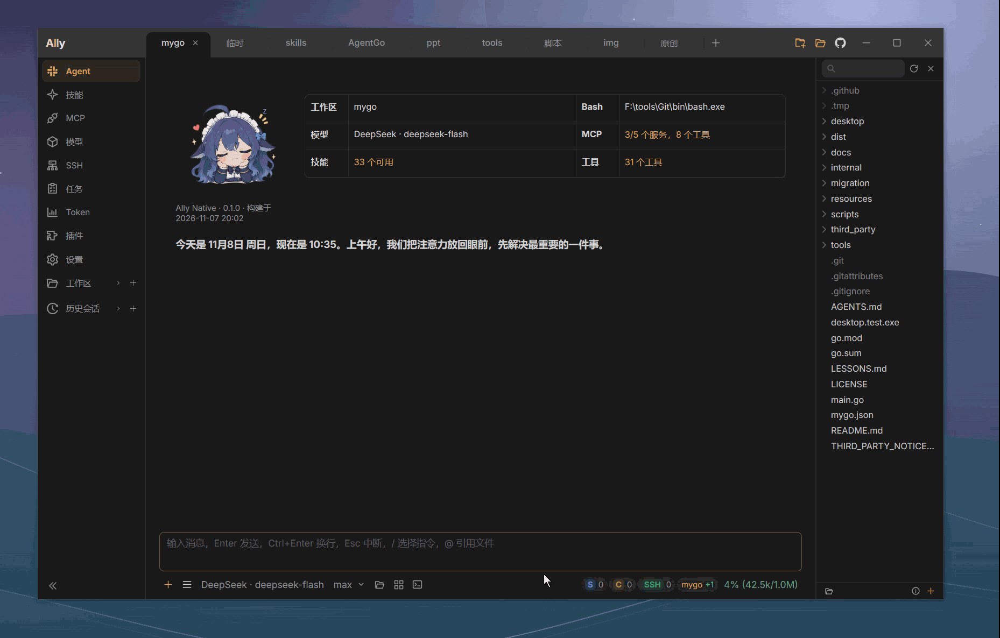
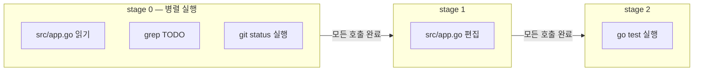

[简体中文](README.zh-CN.md) · [English](README.en.md) · [日本語](README.ja.md) · [한국어](README.ko.md)

# Ally Agent

Ally Agent는 Go와 [MyGo](https://github.com/egoist/mygo)로 만든 가벼운 네이티브 데스크톱 AI 코딩 도우미입니다. Windows, macOS, Linux를 지원하며, 대화로 프로젝트를 이해하고 코드를 수정하며 명령을 실행합니다. SSH 노드를 승인하면 원격 호스트에서 작업할 수도 있습니다.

**낮은 리소스 사용량, 여러 작업 공간과 하위 에이전트의 병렬 작업, 헤드리스 실행과 로컬 HTTP API, 자유로운 모델 공급자 선택. 코딩하는 동안 큰 고래가 곁을 지켜 줍니다.**

⭐ Ally가 도움이 되었다면 GitHub에서 Star로 응원해 주세요. 감사합니다!

<p>
  <a href="https://github.com/Bronya0/ally-agent/releases">
    
  </a>
  <a href="https://awesomemygo.dev/apps/ally">
    
  </a>
</p>

[GitHub Releases](https://github.com/Bronya0/ally-agent/releases)에서 Windows, macOS, Linux 패키지를 다운로드하세요.



## 주요 기능

### 로컬 코딩과 원격 개발

- 프로젝트 파일 읽기, 검색, 생성, 편집, 삭제. 작업 공간 경계와 파일 버전 검증으로 쓰기를 보호합니다. ripgrep가 패키지에 포함되어 별도 설치가 필요 없습니다.
- 채팅에서 시각적 Diff, 여러 파일의 변경, 명령 출력, 도구 오류를 확인하고 네이티브 파일 탐색기와 편집기를 사용할 수 있습니다.
- 승인된 SSH 노드에서 원격 파일을 읽고 쓰며 명령을 실행하고, 로컬과 원격 사이에 파일이나 디렉터리를 전송합니다. 로컬 SSH 설정·Agent, 개인 키, 비밀번호 인증을 지원합니다.
- 여러 작업 공간과 대화를 관리하고 복잡한 작업을 병렬 하위 에이전트에 맡깁니다. 단계, 도구 활동, Token 사용량, 결과를 실시간으로 확인합니다.
- 짧은 명령과 백그라운드 프로세스를 실행하고 작업 센터에서 로그를 확인합니다. Windows에서는 Git Bash를 자동으로 찾고 필요하면 PowerShell을 사용합니다.

### 모델과 대화

- OpenAI Chat Completions, OpenAI Responses, Anthropic Messages 및 호환 서비스를 지원합니다. ChatGPT 로그인으로 계정에서 사용 가능한 모델에도 연결할 수 있습니다.
- 작업 공간마다 모델을 선택합니다. 공급자·모델 프리셋과 추론 강도, 출력 한도, 컨텍스트 창, 사용자 지정 요청 헤더를 설정할 수 있습니다.
- 여러 API Key를 우선순위에 따라 전환하고 대기 시간 후 복구합니다. 공급자의 추론 필드를 표시하며 `reasoning_content`, `think`, `sink` 같은 태그도 설정할 수 있습니다.
- 이미지를 첨부해 비전 모델에 보내고 생성된 이미지를 채팅에서 미리 봅니다. Windows에서는 음성 전사 모델을 설정하고 단축키를 누른 채 말하면 입력창에 텍스트가 채워집니다.
- 대화 기록을 저장하고 모델 요약이나 로컬 잘라내기로 긴 컨텍스트를 압축합니다. Token 대시보드에서 사용량 추이를 확인할 수 있습니다.

### 도구와 확장

- MCP의 stdio, SSE, Streamable HTTP를 지원합니다. 폼이나 JSON으로 서버를 설정하고 새 대화에 제공할 도구를 선택합니다.
- 작업 공간과 사용자 디렉터리의 Skills를 자동으로 찾아 본문과 참조 파일을 필요할 때 읽습니다. 전역 기억으로 프로젝트 간 지식을 저장합니다. `ally-agent`, `playwright-cli`, `anydoc`, `md2other` 등이 포함됩니다.
- 웹 페이지 수집과 HTTP API 호출에 응답 크기, 시간 제한, 리디렉션 제한, 호스트별 호출 빈도 제한을 적용합니다.
- 채팅에서 샌드박스 HTML, Mermaid 다이어그램, 구문 강조 코드를 미리 봅니다. 다이어그램은 휠 확대·축소, 드래그 이동, 더블클릭 초기화를 지원합니다.
- ZIP으로 JS/TS 플러그인을 설치해 사이드바 페이지를 추가합니다. 공개 호스트 API로 HTTP, 저장소, 작업 공간 접근 기능을 사용합니다.
- 플러그인, 스크립트, IDE, 자동화를 위한 [로컬 HTTP API](api.md). Todo와 영구 저장된 예약 작업을 관리하며 재시작 후에도 예약을 이어갑니다.

### 네이티브 데스크톱

- 기본 UI와 일반 페이지는 Go와 [MyGo](https://github.com/egoist/mygo)로 네이티브 렌더링합니다. 플러그인과 HTML, Mermaid, 미디어 미리보기는 필요할 때 관리되는 WebView를 사용합니다.
- 다크, 라이트, 현지 시각에 따른 자동 전환과 여러 색상을 제공합니다. 글꼴 크기와 채팅 배경 불투명도도 조절할 수 있습니다.
- 큰 고래, 작은 로봇 등의 시작 화면 아바타와 데스크톱 펫을 제공합니다. 사용자 이미지도 사용할 수 있습니다.
- Windows와 macOS는 업데이트 자동 다운로드와 재시작 안내를 지원합니다. Linux는 버전 확인과 수동 업데이트를 지원합니다.
- Windows·macOS 시스템 프록시를 따르거나 HTTP/HTTPS/SOCKS5를 직접 설정합니다. 모델, HTTP 도구, MCP, 명령, 백그라운드 서비스에 공통으로 적용합니다.
- 중국어 간체, 영어, 일본어, 한국어 UI를 지원합니다. 기본적으로 시스템 언어를 따르고 지원하지 않는 언어는 영어로 표시합니다. 설정에서 즉시 변경할 수 있습니다.

## 시작하기

1. [GitHub Releases](https://github.com/Bronya0/ally-agent/releases)에서 플랫폼에 맞는 패키지를 다운로드합니다.
2. Ally를 실행하고 프로젝트 디렉터리를 선택합니다.
3. **모델** 페이지에서 공급자를 추가하고 모델 이름, API URL, API Key를 입력하거나 ChatGPT로 로그인합니다.
4. 채팅 입력창 아래에서 모델을 선택하고 작업을 보냅니다. 원격 개발에는 SSH 노드를 추가한 뒤 현재 작업 공간에서 승인하세요.

Windows는 ZIP을 풀고 `Ally.exe`를 실행합니다. macOS는 DMG를 열고 `Ally.app`을 응용 프로그램 폴더로 옮깁니다. 앱은 ad-hoc 서명을 사용하며 공증되지 않았습니다. 첫 실행이 차단되면 다운로드 출처를 확인하고 **시스템 설정 → 개인정보 보호 및 보안**에서 **확인 없이 열기**를 선택하세요. Linux는 x64와 ARM64 압축 패키지를 제공하며 현재는 직접 다운로드하고 교체해야 합니다.

기존 `~/.ally_agent` 설정과 대화 데이터를 이어서 사용합니다. Enter는 전송, Ctrl+Enter는 줄바꿈, Esc는 현재 대화나 도구 호출 중단입니다.

## 큰 고래와 함께 코딩하기

새 사용자는 기본적으로 큰 고래 아바타와 데스크톱 펫을 사용합니다. **설정 → 일반 → 모양**에서 아바타를 바꾸고 펫을 조절하거나 끌 수 있습니다.

- 몸을 드래그해 이동하고 머리를 클릭해 상호작용합니다. 크기와 위치는 저장됩니다.
- 우클릭 메뉴에서 머리 쓰다듬기, 말 걸기, 호감도 확인, 크기 변경, 혼잣말 켜기·끄기를 선택합니다.
- 작업 상태에 맞춰 움직이고 완료 시 소요 시간을 표시합니다. 쓰다듬기와 작업 완료로 호감도가 쌓이며 아바타별로 기록합니다.
- 혼잣말은 로컬 문구를 사용하며 모델을 자동 호출하지 않습니다. 시작 화면은 같은 아바타를 사용하고 펫이 켜져 있을 때 정지 이미지를 표시합니다.

## 단계별 도구 호출

모델은 한 응답에서 여러 도구를 호출하고 선택적으로 `stage` 번호를 지정할 수 있습니다. 같은 단계의 호출은 병렬로 실행됩니다. 동시 실행 한도 때문에 대기 중인 호출까지 모두 끝나야 다음 단계가 시작됩니다. 실패하면 이후 단계를 중단하고 건너뛴 이유를 모델에 전달합니다. 이미 완료된 쓰기, 설치, 서비스는 되돌리지 않습니다. 따라서 “편집 → 테스트 → 검증”처럼 순서가 필요한 작업을 한 응답에 표현할 수 있습니다.

단계 번호는 순서만 정하며 호출 사이에 값을 전달하지 않습니다. 파일 버전처럼 이전 결과가 필요한 인자는 별도의 대화 라운드에서 보내야 합니다.



## 플러그인

플러그인은 매니페스트와 페이지 소스가 담긴 ZIP입니다. JavaScript/TypeScript로 작성하며 Ally 재빌드나 재시작이 필요 없습니다. `host` API는 HTTP, 플러그인 전용 저장소, 작업 공간 읽기, 이벤트, 테마를 제공합니다. AI와 대화 기능은 [로컬 HTTP API](api.md)로 호출합니다.

**플러그인** 페이지에서 ZIP 가져오기·드래그, 압축을 푼 디렉터리에서 설치, 플러그인 데이터 포함 여부를 선택하는 내보내기, 활성화, 비활성화, 삭제를 할 수 있습니다.

최소 `plugin.json`:

```json
{
  "id": "my-helper",
  "name": "티켓 도우미",
  "version": "1.0.0",
  "entry": "index.js",
  "menu": [{ "key": "helper", "title": "티켓", "icon": "ApiOutlined" }],
  "permissions": { "http": ["api.example.com"], "workspace": "read" }
}
```

진입 모듈은 `mount(element, host)`를 내보내고 정리 함수를 반환합니다.

- 정의되지 않은 매니페스트 키는 가져오기 중 거부됩니다.
- `permissions.http`에 없는 호스트로의 HTTP 요청은 거부됩니다.
- 같은 `id`를 다시 가져오면 덮어쓰기 업데이트를 하며 `host.store` 데이터는 유지합니다.
- 독립된 WebView와 공개 호스트 API를 사용하며 이전 Wails 바인딩은 주입하지 않습니다. 신뢰하는 플러그인을 설치하세요.
- 첫 방문 시 페이지를 만들고 최대 3개 WebView를 캐시합니다. 해제된 페이지는 다음 방문 때 다시 로드하므로 중요한 상태는 저장해야 합니다.

API, 스타일, 주의 사항은 [plugin-system.md](plugin-system.md)를 확인하세요. AI 도우미에게 이 문서를 전달해 플러그인 작성을 맡길 수도 있습니다.

## 로컬 빌드

Go 1.27.3과 Python 3.9+가 필요합니다. UI는 [MyGo](https://github.com/egoist/mygo)를 사용합니다.

| 플랫폼 | 스크립트 | 결과물 |
| --- | --- | --- |
| Windows | `scripts/build.bat` | `dist/ally-native.exe`, `dist/tools/rg.exe` |
| macOS | `scripts/build.command` | 현재 아키텍처용 `dist/Ally.app` |

저장소 루트에서 실행:

```bash
go run .
python scripts/build.py dev
```

모든 플랫폼의 릴리스 빌드는 macOS에서 안정 버전 태그를 지정해 실행합니다.

```bash
BUILD_TAG=v2.1.0 bash scripts/build-all.sh
```

Windows x64/ARM64, macOS Universal/Intel/Apple Silicon, Linux x64/ARM64 등 7개 패키지를 생성합니다. 자세한 내용은 [업데이트 호환성 문서](update-compatibility.md)를 확인하세요.

## 라이선스

Copyright (C) 2026 Bronya0.

Ally는 [GNU General Public License v3.0 only](../LICENSE)(`GPL-3.0-only`)로 배포되는 자유 소프트웨어입니다. 라이선스에 따라 사용, 연구, 수정, 재배포할 수 있습니다. Ally나 수정 버전을 배포할 때는 해당 소스 코드를 제공하고 GPLv3 고지를 유지해야 합니다.

포함된 [ripgrep](https://github.com/BurntSushi/ripgrep)는 MIT/Unlicense를 따릅니다. 다른 외부 리소스는 각 라이선스를 유지합니다. [THIRD_PARTY_NOTICES.md](../THIRD_PARTY_NOTICES.md)를 확인하세요.

## 연락처

피드백, 제안, 협업: [tangssst@qq.com](mailto:tangssst@qq.com)

## 참고 프로젝트

일부 구현은 아래 프로젝트와 기술 문서를 참고했습니다. 각 프로젝트에는 자체 라이선스가 있으며 Ally는 이들과 독립된 프로젝트입니다.

- [Anthropic — Building Effective Agents](https://www.anthropic.com/engineering/building-effective-agents)
- [DeepSeek Harness](https://github.com/deepseek-ai/deepseek-harness)
- [Anthropic — Managed Agents](https://www.anthropic.com/engineering/managed-agents)
- [Kimi Code CLI (kimicode)](https://github.com/MoonshotAI/kimi-code) — 라이트 색상, 이미지 Token 추정, 중단 안내
- [Codex CLI](https://github.com/openai/codex) — Responses 세션 캐시 키와 사용량 필드
- [pi](https://github.com/earendil-works/pi) — 유사 편집 일치, 컨텍스트 추정, 추론 수준, 한도 초과 복구
- [OpenCode](https://github.com/sst/opencode) — 요청 헤더와 User-Agent 호환성

<sub>고래 팬아트는 <a href="https://github.com/Small-tailqwq/dsh-deep-whale">dsh-deep-whale</a>에서 CC BY-NC-SA 4.0으로 제공됩니다. <a href="../resources/avatar/whale/README.md">작가 표기 및 리소스 설명</a>.</sub>
