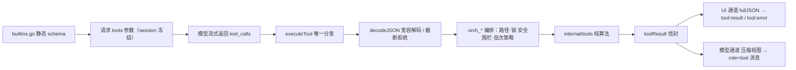

# Ally Agent Core：工具系统代码导读

> 本文是 `agent-core-loop.md` 的续篇，讲「模型说要调工具」到「模型看到工具结果」之间的全部代码。
> 工具系统是 agent 中唯一有副作用的一环，也是最容易写歪的一环。
> 行号基于撰写时的工作区版本，重构后可能漂移；定位以「函数名 + 文件」为准。

## 一、管道全景



| 环节 | 位置 |
|---|---|
| schema 声明 | `internal/tools/shared/builtins.go` |
| schema 查找（按工具名） | `builtins.go:98` `BuiltinSchema` |
| 内置工具集组装 | `biz_mcp.go` 的 `buildToolsForSession` 和 `buildToolsForConfig` |
| MCP 注册、目录与调用 | `biz_mcp.go` 和 `biz_mcp_registry.go` |
| 分发 | `app.go:2375` `executeTool` |
| 参数契约（宽容解码 + schema 闸门） | `app.go:2399` `decodeJSON` + `internal/tools/schemautil/validate.go` + `internal/tools/toolcall/` |
| 编排（绑定 `*App` 状态） | `internal/app/orch_*.go` |
| 纯算法 | `internal/tools/<name>/` |
| 结果信封与模型视图 | `internal/app/infra_result.go` |
| 批次策略 | `internal/app/orch_batch_policy.go` |

## 二、声明层：schema 是静态的、共享的、strict 的

`internal/tools/shared/builtins.go`：

```go
func Builtins() []openai.Tool {           // :78
    chatToolsCache.once.Do(func() { chatToolsCache.tools = chatToolsUncached() })
    return chatToolsCache.tools            // 共享只读：调用方不得改 slice 或 Parameters
}
func functionTool(name, desc string, params map[string]any) openai.Tool {  // :490
    if ex := builtinToolExamples[name]; ex != "" { desc += " Canonical JSON example(s): " + ex }
    return RawFunction(name, desc, enforceStrictSchema(params))
}
```

几个值得学的做法：

1. **示例写进描述**（`builtinToolExamples`，`builtins.go`）。参数描述说一百句，不如给一条能直接抄的样例 JSON——提升工具调用成功率最便宜的手段。
2. **平坦 Schema 与网关最大兼容**：内置工具 Schema 全面使用平坦的 `type: "object"`，彻底避免顶层与嵌套的 `oneOf` / `anyOf` / `allOf` / `not` 等复合关键字，防止中转网关（OneAPI、NewAPI、Cloudflare AI Gateway）或不同模型端点 400 拒绝。参数互斥（如 `body` 与 `json`、`oldText` 与 `lineRange`、`instruction` 与 `command`）直接在参数 description 中给出清晰说明，并由执行层业务逻辑统一校验。
3. **入参门禁放宽与按需取用**：针对多 action 工具（如 `service`、`scheduled_task`、`ssh_cluster`），顶层仅强制要求基础 action 字段（`required: ["action"]`）。调用时若携带了当前 action 不需要但在 properties 中有声明的冗余参数，后端自动忽略而不拒绝；仅当当前 action 真正需要的必选参数缺失或互斥参数冲突时，才在执行层返回针对性报错。
4. **strict schema 递归规范化**（`enforceStrictSchema` → `normalizeSchemaNode`）。遍历 `properties` / `items` 等，给每个 `type: object` 补 `additionalProperties: false` 与 `properties: {}`，确保在 OpenAI strict 模式下行为确定。

主会话首次请求固定内置工具集合。子代理和定时任务按各自获得的工具集合执行。MCP 启停与刷新保持协议工具声明稳定。管理器分页读取服务端的原始工具定义，连接恢复或收到列表变更通知后按服务器更新。

运行时消息携带按服务器和工具名排序的 MCP 目录。「上下文加载 → MCP 工具清单」开启且 ToolExec 可用时，目录在同一会话只发送一次；目录变更不追加，成功压缩移除旧目录后才补新目录。关闭清单不停止连接、不改变工具权限；目录和系统前缀共用自动加载总预算，超限拒发而不静默隐藏工具。用 `ToolSearch({"query":["github.search_repositories","mysql.list_tables"]})` 一次取回多项完整定义。`query` 的每一项要么是精确的 `server_id.tool_name`，要么是服务器 ID，后者展开该服务器下全部工具；结果按传入顺序返回。没有模糊匹配，不确定名字就看目录。每项独立返回结果或错误，查询全程读取本地注册表。已知参数时可以直接用 `ToolExec({"name":"mysql.list_tables","arguments":{}})`。执行时检查目标是否仍可用，并按当前服务端 InputSchema 校验。工具名区分大小写，服务器 ID 中的点转义为 `%2E`。

## 三、分发层：`executeTool` 是唯一入口（`app.go:2375`）

主循环、子代理、计划任务三条路径都调用它，因此所有公共契约在这里收口：

```go
defer func(){ if r := recover(); r != nil {       // ① handler panic → E_TOOL_PANIC
    result = toolErrorResult(codedToolError("E_TOOL_PANIC", ...)) } }()
name = normalizeToolName(name)                     // ② 小写 + 别名/弃用名归一
if toolcall.IsTruncatedArguments(string(args)) {   // ③ 流式截断参数一律不执行
    return toolErrorResult(codedToolError("E_TRUNCATED_ARGS", ...)) }
switch name {
case "fetch": ...  /* 工具分支以实际注册清单为准 */
case "skill": ...
case "toolsearch", "toolexec": ...               // ④ 按 MCP 注册表定位目标
default:
    err = fmt.Errorf("unknown tool: %s", name)
}
if err != nil { return toolErrorResult(err) }
return toolResult{OK: true, Data: data, Warnings: argWarnings}   // app.go:2797
```

要点：

- **① panic 隔离**：循环跑在独立 goroutine 里，一次 handler panic 逃逸就会带走整个应用；文件变更阶段 panic 还会带着悬空 `tool_calls` 进入 deferred 检查点落盘。这里统一转成工具错误，循环继续。
- **② 归一化收在一处**（`NormalizeName`）：历史会话里的旧工具名靠别名映射继续可用；不要在别处用排除式补丁（`!= 'specal_case'`）替代归一。
- **③ 截断参数的唯一契约**是 `toolcall.TruncatedArgumentsMarker`。
- **④ MCP 调用**按实时注册表检查目标权限，历史目录和已查询的 Schema 供模型参考。

## 四、参数契约：`decodeJSON` + schema 闸门 + `toolcall` 包

`decodeJSON`（`app.go:2399`）是「宽容解码、严格报错」的示范：

| 情况 | 处理 |
|---|---|
| 未知参数键 | 忽略并进 `Warnings`（报出键名与路径），工具照常执行；缺必填、类型、范围、枚举等仍然失败 |
| 值被双重编码（`{"files":"[{...}]"}`） | 按字段路径自动修复一次并记 warning（`repairToolArgJSON`、`maxToolArgRepairRounds`）；校验跑在修复后的载荷上 |
| JSON 被流截断（`isIncompleteStreamJSON`） | 明确报 "tool arguments JSON was truncated"，edit 类工具附可操作建议 |
| 类型 / schema 错 | 失败报错，且**不能**误标成截断（历史上这个混淆让老的 `oldString` 调用看起来像耗尽了 max_tokens） |
| 参数是截断标记 | `E_TRUNCATED_ARGS` 直接拒绝执行 |

**schema 闸门**（`app.go:2399` 内 → `schemautil.ValidateArgs`，`internal/tools/schemautil/validate.go`）：内置工具的入参在解码后按它自己的 schema 校验一次，支持 `type` / `required` / `additionalProperties` / `items` / `min–maxItems` / `min–maxLength`（按字符）/ `pattern` / `enum` / `const` / `minimum` / `maximum` / `anyOf` / `oneOf` / `allOf` / `not`，报告带路径（`changes[0].newText`）且一次列多个问题。两条约定：**`null` 等于「没提供」**（跳过类型检查，也不再满足 `required`），未被声明用到的关键字忽略不拒。它针对「模型看到的就是它要遵守的」这件事——同名规则不再一处写在提示词、一处写在 handler：

- `ToolExec` 的外层参数按内置工具契约校验。嵌套的 `arguments` 保留原样，按服务端原始 JSON Schema 校验。
- 每条声明必须能过闸才能存在：`TestEveryBuiltinSchemaIsEnforceable`（strict object + pattern 可编译）、`TestExecuteToolGatesEveryBuiltinTool`（25 个名字逐个验闸）守住。

`internal/tools/toolcall`（179 行）是「适配器产出 / 会话加载修复 / 执行前拒绝」三条路径共享的规则源——包注释说明了原因：这套知识曾经散在三处，改一份就会和另两份静默不一致。内容包括：

- `ForAnthropic` / `ForResponsesCall` / `Effective`：id 归一化，共用同一个 `sanitize` 核心（保留 `[a-zA-Z0-9_-]`，超 64 字符截 56 + sha256 前 7 位防碰撞）；
- `DecodeArguments`：非 object 的 JSON 包成 `_raw` 而不是丢弃；
- `MergeRepeatedDelta`：中转重发全名时不会拼出 `http_requesthttp_request`；
- `TruncatedArgumentsMarker` / `RepairTruncatedArguments` / `IsTruncatedArguments`。

## 五、编排层：`orch_*` 是纯算法与 App 状态之间唯一的粘合点

| 关注点 | 收口位置 |
|---|---|
| 工作区写串行 | `withFileOpsLock`（`app.go:2369`）；用 defer 解锁，因为 executeTool 会把 panic 转成错误，手写 Unlock 会在那条路径上永久卡死 |
| 编辑后验证 | `attachValidation` + `validateChangedFilesForCall`（`orch_validation.go:170`）；批次里由 `planBatchValidation`（`orch_validation.go:189`）摊到「最后一次触碰该目录的变更」上，避免每个 edit 都跑一遍 `go vet` / `tsc` |
| 命令安全围栏 | `checkCommandSafetyAtCwd`（`orch_fence.go:48`）：**唯一入口**，本地命令与后台服务共用；受保护位置是一张表（`protectedLocations`：每项带 `remove` / `scan` 两列，删除守卫只登记深度规则兜不住的目标，搜索守卫没有深度概念、逐个点名一级系统树；`removableProtectedTargets()` 同时喂远端 helper），`isDangerousDeletePath` / `isDangerousSearchRoot` 各取一列，同在 `orch_fence.go` |
| 密钥/凭据禁读（三平台） | `pathutil.SensitiveReadReason`（`internal/tools/pathutil`）：`~/.ssh`、`~/.aws`、`~/.gnupg`、`~/.kube`、`~/.docker/config.json`、`~/.netrc`、`~/.git-credentials`、`~/.npmrc`、`~/.pypirc`、`~/.config/{gcloud,gh,glab-cli}`、平台钥匙串、Ally 自己的 `config/api/mcp/ssh_clusters.json`。三条入口共用同一份判定：命令围栏（`firstSensitiveReadTarget` + `command.DisclosingPathOperands`，只算「可能把内容交回来」的操作数：`ssh -i KEY`、`chmod 600 KEY`、`ls ~/.ssh` 这类只是用密钥不算读，照常放行；`cat ~/.ssh/id_rsa` 仍拦）、`read`、`grep`；`memories/` 与 `USER.md` 照旧可读 |
| 路径保护 | `pathutil`：`CanonicalPath` 统一路径形态；本地、SSH 工具与传输不对 `.git/.svn/.hg` 做特殊限制或跳过 |
| 删除多路径 | `resolveDeletePathList` / `planDeleteExecution` / `applyDeletePlanSlots`（`orch_file_ops.go`）：`paths` 先归一成一条候选列表，再按「去重 + 深的先删」排出执行计划（同一路径的两种写法只执行一次；父子同时列出时深的先删，两条都真删掉），结果按请求槽位摊回去；本地与远端共用这一份。单条路径的落盘判定仍各自留在自己的信任域（本地问本机文件系统，远端只能在 SSH 另一头问）。「本来就不存在」两端一致：不是失败、不拦同批其它路径，只报 `DeleteResult.Absent`（本地 `resolveDeleteTarget`，远端 `check_delete_path` 的 `missing` 标记） |

命令围栏的三道检查都是「拒绝并解释」，不是「尝试纠正」：

1. 显式删除命令 → 拦截，要求改用 `delete` 工具（delete 工具自带工作区边界与递归范围检查）；
2. 写入目标在工作区外**且已存在** → `E_PATH_OUTSIDE`（允许读、允许写 `/dev/null`、允许创建新路径；并解析符号链接，拦截「经工作区内软链逃逸到外面」的写法）；
3. 高危模式（`MatchRiskPattern`）→ `E_COMMAND_BLOCKED`。

远端命令保留第 1、3 道：`ContainsExplicitDeleteCommand` 拦裸删除，`validateRemoteCommandSafety` 检查高危语义；不对 VCS 元数据做特殊检查。远端不再设置项目目录边界，也不再检查“目录外已有目标”。`alias` 原样使用 `ssh_cluster` 返回的唯一昵称，每次调用必传，只选服务器，文件工具与传输使用绝对路径；命令每次在登录用户家目录启动独立 shell，通过 `cd /绝对目录 && 命令` 切目录。远端命令不再提取写目标来检查 VCS。不兼容旧 `target`、带目录端点和远端 `cwd`；读取统一使用 `files`。主代理和子代理共用的新提示词说明此契约。

写根是主工作区 + 会话级附加工作区（`roots` 全量，不是只有 `roots[0]`），且**每条命令现算**：在 Tab 上加/删附加工作区，下一条命令立即生效。

错误文案是写给模型看的：**说清原因 + 给出下一步该怎么做**。

## 六、结果层：一个信封、两条通道（`infra_result.go`）

```go
type toolResult struct {                       // infra_result.go:19
    OK        bool   `json:"ok"`
    Data      any    `json:"data,omitempty"`
    Error     string `json:"error,omitempty"`
    ErrorCode string `json:"errorCode,omitempty"`
    Details   any    `json:"details,omitempty"`
    Warnings  []string `json:"warnings,omitempty"`   // 非致命提示（如被忽略的未知参数）
}
```

- **UI 通道**：`fullJSON` 进 `tool:result` / `tool:error` 事件（前端展示完整数据）。敏感凭据通过 `ssh_cluster` 安全资产池持久化并在模型侧严格脱敏，不再直接流经提示词历史。
- **模型通道**：`compactToolResultForModel`（`infra_result.go`）产出 `role=tool` 消息的 `Content`。

压缩是逐工具定制的——**给模型的视图和给人的视图本来就该不一样**：

| 工具 | 模型视图 |
|---|---|
| `read` | `<ally-file path version lines total>` 标签块，行号正文零转义；本会话已读过的同一 path/range → 内容换成「已给过你、version 未变、可复用」说明（会话级 read cache，`sessionReadCacheFor`，`remote_read` 共用同一份：后续 run 也复用；改盘不触发失效——命中靠逐字节比对载荷哈希；只有压缩 / 删回合 / 历史从磁盘重载才失效） |
| `read` 图片 | 内容转为后续 user 消息的图片输入，块里只留 `image="…"` 说明 |
| `grep` | `<ally-grep mode matched hits files next-offset>` 头 + `path:line: text` 行（count 模式为 `path: count=N`）；命中行文本按预算裁剪（`capGrepLineTexts`） |
| `command` | `<ally-command exit timed-out promoted-to-service truncated reduced-from full>` 块，输出零转义落体；模型侧另有一条 12KB 预算（头 4KB + 尾 8KB，中间以省略标记替换，`reduced-from` 报裁剪前长度，尾部一行说清去哪里拿全量）；command/cwd 不回显（模型刚在参数里写过） |
| `service` read/info | `<ally-svc-read>` / `<ally-svc>` 块（字节账目走属性），`list` 仍走 JSON |
| `edit` / `create` | 自闭合属性标签；summary/validation 走属性，warnings 走尾部行（自由文本经 `neutralizeClosingMarkers` 中和标记形状） |
| `delete` / `remote_delete_path` | `<ally-deleted deleted failed absent>` 块 + 每条路径一行 `<path value ok absent kind files dirs bytes error>`：单路径调用就是一个单槽批量，本地与远端同一份渲染（失败槽一眼可见，不用数行）。本来就不存在的路径报 `absent="true"`（`ok` 仍为 true，两个计数都不含它）——不报错、也不必重试 |
| `fetch`（兼容历史 `http_request` / `web_fetch`） | `<ally-http>` / `<ally-fetch>` 块（砍 url/statusText 回显，链接作尾部行） |
| `ToolExec` | 第三方无上限输出，统一夹到内置上限（`renderMcpResultForModel`） |
| 任何失败 / 解码失败 | 回退 `fullJSON`（`marshalToolResultOrFallback`），永不因压缩丢信息 |

正文或自由文本自带闭合标记形状时统一就地转义（`</ally-x` → `&lt;/ally-x`，收口在 `escapeClosingMarker`）：字面闭合标记只允许渲染器自己写的那一个，外部内容无法伪造块边界，也没有任何回退路径需要保 cap。转义在 cap 之后发生，极端对抗性内容（密集标记）最多膨胀约 1/3，测试按 1.5 倍上限覆盖。

`injectEnvelopeWarnings` 把参数警告合并进 `data.warnings`，解析失败就退化成追加一行纯文本——**通知必须送达模型**。

`toolResultSummary`（`infra_result.go:60`）是给人看的短摘要（如 `3 files · +12 -4`、`exit 0 (2s)`），子代理卡片用它展示进度（`orch_subagent.go:333`）。时长统一走 `FormatDurationMS` 的整秒格式，卡片、摘要与任务中心读同一个数。

## 七、批次策略：按 stage 调度

主循环与子代理共用 `orch_tool_stages.go` 的 `executeStagedToolBatch`。内置工具 schema 在 `functionTool` 统一声明可选非负整数 `stage`，省略为 0；调度器读取它，但不从执行参数中剥离。`ToolExec` 使用外层 `stage` 参与调度。嵌套的 `arguments.stage` 如有声明，按目标工具参数转发。

- 同 stage 在配置的并发上限内执行；阶段按数字升序推进，数字允许不连续，与调用在响应中的排列顺序无关。
- 当前阶段全部收尾后才能进入下一阶段。工具错误、命令非零退出、超时、取消或提升为后台服务都会阻断后续阶段；`E_DUPLICATE_TOOL_CALL` 通知本身不阻断，原始调用的成败仍然有效。
- 后续调用不执行，返回 `E_STAGE_BLOCKED`；若已有自己的冲突码，则保留原始原因。UI 隐藏纯跳过结果并移除占位卡片，模型仍收到配对结果。已完成的写入、安装和服务不回滚。
- `wait` 是普通阶段调用，没有隐式排尾。例如修改放 stage 0，独立安装放 stage 1，启动服务放 stage 2，wait 放 stage 3，检查放 stage 4。
- stage 不做结果插值。依赖前一步返回的 version 等参数时，仍需分轮调用。

`orch_batch_policy.go` 的 `detectToolBatchConflicts` 保留执行前校验：

1. **独占工具**：`ask` / `suggest` 必须独占整个响应，否则所有调用均返回相应的独占冲突码，不产生副作用。
2. **同阶段同路径多写**：本地和远端按规范化目标检测，只允许最早的调用执行，其他返回 `E_WRITE_BATCH_CONFLICT`。不同阶段不互相冲突，但仍需满足版本、路径与授权契约。
3. **同阶段计划写入**：`steps` / `finish` 每阶段最多一个写操作，其余返回 `E_PLAN_BATCH_CONFLICT`；只读计划调用不算写入。
4. **重复调用**：JSON 参数规范化后去重；内置工具省略 stage 与显式 0 等价。重复调用保留 `E_DUPLICATE_TOOL_CALL` 通知，但不因此阻断后续阶段。

非法 JSON 或非法 stage 在执行前拒绝整批，错误结果明确指出违规的调用索引与工具名；这避免在无法确定调度顺序时先产生副作用。每次调用都保留模型侧结果。

文件写入完成后，`planBatchValidation` 仅合并本阶段成功写入的校验单元，再串行校验；每个阶段独立享有 12 秒校验预算，写入不消耗校验预算。跨阶段再次修改同一单元需要重新校验，不能拿前一阶段结果证明新内容正确。

## 八、可复用的设计原则

1. **双视图**：给人看的（保真）与给模型看的（省 token、可读）分开生成，别共用一份 JSON。
2. **规则下沉、编排只绑定**：跨路径共享的判定（工具名归一、id 归一、截断标记、路径保护）放进 `internal/tools/*` 纯函数包，`orch_*` 只负责接 App 状态（锁、工作区、授权）。改一处即全局生效。
3. **护栏式拒绝 + 可操作文案**：安全判定一律「拒绝 + 解释原因 + 告诉模型该改用哪个工具」。
4. **把模型输出当不可信输入**：工具参数可能被截断、可能双重编码；命令与路径要过静态分析围栏。
5. **冻结与共享只读**：schema 缓存、session 工具集都是「建一次、只读共享」，既省开销又保住请求前缀稳定。

## 九、建议阅读顺序

1. `app.go:2375-2798` —— 分发 + `decodeJSON`
2. `internal/tools/toolcall/toolcall.go` 全文（179 行，规则最集中）
3. `infra_result.go:19-48`、`178-1213` —— 信封 + 模型视图
4. `orch_batch_policy.go` 全文 —— 批次策略
5. `orch_fence.go` 全文 —— 安全围栏
6. `builtins.go:117-512` + `514-763` —— schema 生成与 strict 化
