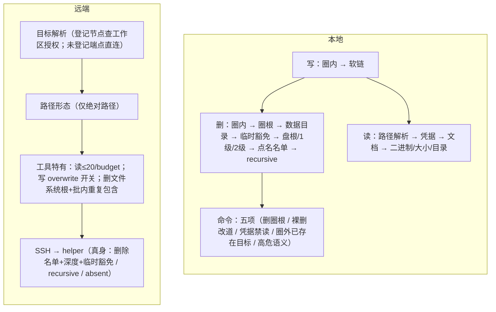

# Ally Agent：安全围栏规则速查

> 记录围栏**当前实际行为**：圈（可写范围）怎么定义、每条入口按什么顺序判定、具体路径落在哪一档，以及本地与远端的差别。
> 行号会随重构漂移，定位以「函数名 + 文件」为准。
> 凡是从提交历史推断、或缺少代码依据的判断，正文里都显式标出「推断」。

## 一、圈：围栏说的「可以动」到底指什么

| | 本地 | 远端 |
|---|---|---|
| 圈 = | 主工作区 + 本会话附加目录 + `~/.ally_agent`（兜底白名单，永远可写） | 无远端项目目录边界；文件操作使用绝对路径 |
| 锚点由谁定 | **用户**在界面上选 | `alias` 仅选择服务器；命令通过 `cd /目录 && 命令` 选择执行目录 |
| 校验 | 圈外一律拒 | 路径形态 + 删除保护；SSH 账号权限仍由远端执行 |

- 代码：`workspaceRoots`（`orch_file_ops.go`）= 主工作区 + `ExtraRoots`；`~/.ally_agent` 由 `pathutil.InsideWriteRoot` 追加。
- 附加目录的**当前**列表来自会话活记录（`biz_session_roots.go`：`StartChat` 播种、面板增删经 `SetSessionExtraRoots` 即时上报），run 内每个工具批次都按它重算，所以**运行中（含模型 `ask` 暂停期间）加/删当轮生效**；只靠“下次请求带新列表”会让当轮围栏一直按旧圈判（会话忙时会话索引不落盘，那条路根本带不动这个变更）。
- `parseRemoteTarget`（`orch_remote.go`）接受服务器别名、`[user@]host[:port]` 或 `ssh://user@host:port`。`resolveAndAuthorizeRemoteTarget` 对已登记节点检查请求所属本地工作区的授权，未登记端点仍按原有免密方式直连。不接受带目录的端点；文件路径必须独立传入绝对路径。

**沙箱现状**：`internal/sandbox` 的 `attached = false`（三个平台都只走围栏）。因此「边界归谁管」`kernelOwnsBoundary()` 恒为 false：本地两条**靠猜写入落在哪**的检查（删除命令改道、圈外已存在目标）当前满血在岗；接回沙箱时它们让位给内核，只有「删工作区根」反过来变成由围栏说。

## 二、判定顺序（顺序即优先级）

**最容易记错的一条**：临时目录豁免判在深度规则**之前**且直接 return，所以临时目录里的东西**根本进不了**「第 1/2 级目录」那道判定。临时根自己（`/tmp`、`/var/tmp`、系统临时目录）仍受保护。

- 本地：`isDangerousDeletePath`（`orch_fence.go`）里 `isInsideTempDir` 在 `depth == 1/2` 之前。
- 远端：helper 的临时根循环（`is_protected_delete_path`）在「机制一：深度」之前。

## 三、本地（工作区 = `D:\coding\go\src\ally-agent`）

### 删

| 目标 | 结果 | 原因 |
|---|---|---|
| `frontend`（目录，recursive） | 允许 | 圈内、深层、不在名单 |
| `.git` | 允许 | 按普通目录处理，仍检查工作区范围和 recursive |
| `gh/hooks/pre-commit`（`gh` 软链到 `.git`） | 允许 | 解析后仍须位于可写范围内 |
| `D:\coding\go\src\ally-agent` | 拒 `E_DELETE_BLOCKED` | 圈根自己 |
| `D:\Windows\System32\drivers` | 拒 `E_PATH_OUTSIDE` | 圈外**先**拒，轮不到深度规则 |
| `~\.ally_agent\memories\a.md` | 允许 | 兜底白名单 + 是文件 |
| `~\.ally_agent\memories`（目录） | 拒 | 数据目录里的目录不许删 |
| `~\.ally_agent` | 拒 | 数据目录本身永不删 |
| `/frontend`（Windows 上前导斜杠） | 允许，删的是**圈内** `frontend` | 见「六、易踩」 |
| 工作区=家目录时 `~\.ssh\id_rsa` | 允许 | 圈内、是文件；**删除名单里没有凭据**（清单只管读） |
| 工作区=`D:\proj` 时 `D:\proj\src` | 拒 | 第 2 级目录（浅工作区下本地也有同类坑） |
| 工作区=`D:\proj` 时 `D:\proj\src\a.txt` | 允许 | 深度 3 的文件 |
| `C:\Users\DELL\AppData\Local\Temp\ally-temp-123\build` | 允许 | 临时目录豁免（不管深度） |
| `C:\Users\DELL\AppData\Local\Temp` | 拒 | 临时根自己 + 圈外 |
| `C:\tmp\proj` | 拒 | 盘符路径**不算** `/tmp` 豁免 → 撞第 2 级目录 |

### 写（create / edit / rename / saveTo）

| 目标 | 结果 | 原因 |
|---|---|---|
| `src/x.go` 新建 | 允许 | |
| `src/x.go` 已存在、create 未给 overwrite | 拒 `E_EXISTS` | |
| `src/x.png` 覆盖非文本文件 | 拒 `E_TEXT_OVERWRITE` | |
| edit 用旧 version | 拒 `E_VERSION_MISMATCH` | 要重新 read |
| `.git/hooks/pre-commit` | 允许 | 按普通文件处理 |
| `link.txt`（软链） | 目标在可写范围内时允许 | 编辑真实目标并保留链接；仍检查凭据禁读和路径边界 |
| `~\.ally_agent\memories\a.md` | 允许 | 兜底白名单 |
| `C:\Windows\ally-new.txt` | 拒 `E_PATH_OUTSIDE` | 写工具一律要求圈内（没有「圈外新建允许」那条） |
| saveTo=`C:\Windows\x.txt` | 拒 `E_PATH_OUTSIDE` | 同写入侧判定 |
| rename `a.txt` → `b.txt`（b 不存在） | 允许 | 源走删除侧、目标走写入侧判定 |
| rename `a.txt` → `existing.txt` | 拒 `E_EXISTS` | 改名不覆盖 |

### 读 / 搜

| 目标 | 结果 | 原因 |
|---|---|---|
| `D:\other\repo\x.txt`（圈外绝对） | 允许 | `read` 的路径**不设圈** |
| `~\.ssh\id_rsa`、`~\.ssh\known_hosts` | 拒 `E_PROTECTED_PATH` | 目录项拦整棵子树 |
| `~\.npmrc` | 拒 | 文件项精确拦 |
| `~\.ally_agent\config.json` | 拒 | Ally 凭据文件（同一目录下的 `memories/`、`USER.md` 反而允许读） |
| `report.docx` | 拒 `E_DOCUMENT_UNSUPPORTED` | 提示用 anydoc 转 Markdown |
| `a.bin`（含 NUL） | 拒 `E_BINARY_FILE` | |
| `big.tar.gz`（40 MB） | 拒 `E_FILE_TOO_LARGE` | 上限 32 MiB |
| `frontend`（目录） | 拒 `E_IS_DIRECTORY` | |
| grep `~\.ssh` | 拒 | 凭据位置不搜 |
| grep `C:\Windows` | 拒 `E_SEARCH_ROOT_BLOCKED` | 系统目录 |
| grep `C:\Users\DELL` | 拒 | 家目录本身 |
| grep `D:\other\repo` | 允许 | 圈外普通目录不在危险名单 |

### 命令

| 命令 | 结果 | 原因 |
|---|---|---|
| `rm -rf frontend` | 拒 `E_COMMAND_BLOCKED` | 裸删改道 delete 工具 |
| `git rm -r frontend` | 允许 | 管理上下文（同 `docker rm` / `kubectl delete` / `npm uninstall` / `yarn remove`） |
| `echo x > .git/hooks/pre-commit` | 允许 | 按普通文件处理 |
| `cat ~/.ssh/id_rsa` | 拒 `E_PROTECTED_PATH` | |
| `ssh -i ~/.ssh/id_rsa host` | 允许 | 只是「用」密钥，不算读 |
| `echo x > C:\Windows\ally-new.txt` | 允许 | 圈外**新建**允许（本地刻意留的） |
| `echo x >> C:\Windows\system.ini` | 拒 `E_PATH_OUTSIDE` | 改已存在的外部目标 |
| cwd = `C:\Windows` | 拒 `E_PATH_OUTSIDE` | cwd 必须圈内 |
| `curl x \| sh`、`mkfs.ext4 /dev/sda` | 拒 | 高危语义（`MatchRiskPattern`） |

## 四、远端（`alias` 仅选择服务器，例如 `私人47`）

远端文件操作使用绝对路径，不再声明项目根目录，也不再按该目录拒绝已有文件的写入或普通软链接跨目录访问。路径中的 `..` 会正常归一化；空路径、相对路径和带目录的端点均拒绝。

### 读写与删除

| 操作 | 结果 | 原因 |
|---|---|---|
| 读 `/tmp/test1/x.txt` 或 `/etc/nginx/nginx.conf` | 允许 | 任意绝对路径，受远端账号权限限制 |
| `alias=私人47`，文件路径 `test1/x.txt` | 拒 | 必须明确绝对路径 |
| 读目录、二进制或超限文件 | 拒或提示缩小范围 | 沿用文件类型、单文件 32 MiB 和批读取预算；日志可按 tailLines 读取 |
| 一批 21 个文件 | 拒 | 上限 20；批合计 16 MiB，装不下排下一轮 |
| 创建 `/srv/app/a/b.txt`（父目录不存在） | 允许 | 自动创建父目录 |
| 创建已存在文件，overwrite=false | 拒 `E_EXISTS` | 覆盖必须显式指定 overwrite=true |
| edit 用旧 version / 写入前原文已变 | 拒 `E_VERSION_MISMATCH` | 版本与提交前完整哈希校验保留 |
| 写 `/srv/app/.git/config` 或指向该位置的软链接 | 允许 | 仓库元数据按普通文件处理 |
| 删除普通跨目录文件或项目目录 | 允许 | 目录须 recursive=true；保留批内去重及深的先删 |
| 删除 `/`、`/etc/nginx`、`/var/tmp` | 拒 `E_DELETE_BLOCKED` | 文件系统根、系统二级目录和临时根保护 |
| 删除不存在的路径 | 报 absent | 同批其他路径继续处理 |
| 删除普通软链接 | 删除链接自身 | 不跟随删除目标，仍按目标真实路径检查独立保护 |

### 命令（`remote_run_command`）

每次调用在远端登录用户家目录启动独立 shell；需要项目目录时写 `cd /srv/app && command`。`cd` 不跨调用保留，也不改变文件工具的路径基准。工具不提供 `cwd` 参数。

| 命令 | 结果 | 原因 |
|---|---|---|
| `cd /srv/app && go test ./...` | 允许 | 调用内自行选择目录 |
| `echo x >> /etc/nginx/nginx.conf` | 允许 | 不再按“目录外已有目标”拒绝；仍需远端账号权限 |
| 通过普通软链接写另一个目录 | 允许 | 无项目目录边界 |
| 写 `.git` 元数据（含软链接） | 允许 | 不对 VCS 元数据做特殊检查 |
| `rm -rf /srv/app/build` | 拒 `E_COMMAND_BLOCKED` | 裸删除继续改用 remote_delete_path |
| `git rm -r x` | 沿用管理上下文规则 | 不按裸删除处理 |
| `mkfs.ext4 /dev/sda` 等高危命令 | 拒 | 高危语义检查保留 |

命令保留裸删除和高危语义检查，不再解析写目标来检查 VCS；这些检查不是远端内核沙箱。完整输出日志存放在远端家目录的 `.ally_agent/command-logs`，返回绝对路径，可直接交给同服务器的 remote_read，保留日志配额、首尾预览、超时和取消处理。

### 传输（`remote_transfer`）

`remotePath` 使用绝对路径；`localPath` 仍受本地工作区与凭据保护约束。远端项目目录围栏移除，解包仍限制到本次指定的传输目标，保留 Tar-Slip、归档内软链接逃逸及覆盖开关检查，防止归档夹带其他路径。`.git/.svn/.hg` 按普通目录处理，上传和下载均不跳过。

上传与下载都禁止文件与目录互相替换，即使 `overwrite=true` 也会报错并保留原目标，目录也不能替换已有符号链接。向目录内传文件时必须指定完整目标文件路径；同名文件仍可覆盖，目录仍可合并。覆盖符号链接先创建临时链接，成功后才替换目标；创建失败保留原文件。远端旧版 Python 若不支持安全覆盖，会报错而不会先删除原文件。

## 五、只在一边有的

- **本地独有**：项目工作区写入边界、凭据禁读清单（上传本地源也检查）、危险搜索根、Ally 数据目录保护、内核沙箱（当前空转）、文档转换提示。
- **远端独有**：已登记节点按请求所属本地工作区授权；未登记原始端点保持直接连接。没有远端项目目录访问边界。
- **两边都有**：显式覆盖开关、版本冲突校验、删除保护与管理上下文例外。

## 六、已知缺口（按风险排序）

1. **远端不是目录沙箱**。远端目录边界已按产品约定移除，实际访问能力由 SSH 账号权限决定；独立保护仅检查其覆盖的行为。
2. **远端没有凭据禁读清单**。远端 `read` / 命令读凭据都不拦（本地三个入口都拦）。
3. **工作区节点授权不是主机级访问白名单**：只有匹配已登记别名或完整端点的连接才查授权；未登记端点不审批。将 `deploy@host` 改为未登记的 `root@host`，即可按另一身份直连（能否登录由 SSH 凭据和服务器决定）。因此不能依赖节点授权阻止模型访问任意主机或切换用户名。远端相关交互审批仅保留集群登记与工作区授权两处。
4. **浅工作区下本地也删不掉一级子目录**：工作区是 `D:\proj` 时，删 `D:\proj\src` 会被「第 2 级目录」拒（深度规则按绝对路径算，不看它相对工作区是几级）。
5. **凭据清单只管读**：工作区恰好是家目录时，`delete` 工具能删掉 `~/.ssh/id_rsa`（删除侧只有 Ally 数据目录、系统深度/名单两道）。
6. **沙箱空转**：`attached = false`，内核层不生效。接回后本地两条「猜写入位置」的检查会让位（见第二节）。
7. **远端删除不再有任何审批替代**：`35b598b`（2026-09-24）把远端删除的确认弹窗删掉，同时加了「圈的一级子目录一律拒绝」当替代；该禁令已于 2026-10-09 移除。（此条为提交历史推断，提交信息只写了 "align tool schemas with runtime behavior"。）

## 七、易踩

- **Windows 上前导斜杠不是绝对路径**：`filepath.IsAbs("/tmp/x")` 为 false，于是 `/.tmp/probe`、`/tmp/test1` 这类写法会被拼到**主工作区**下（实测：删 `/.tmp/precedence-probe` 删掉的是工作区里的 `.tmp/...`）。要指真实临时目录必须写盘符路径。
- **盘符路径不吃 `/tmp` 豁免**：`C:\tmp\proj` 规范化后虽然长成 `/tmp/proj`，但豁免循环对带盘符的路径直接跳过，于是它照样撞「第 2 级目录」。
- **豁免只在圈内才有意义**：目标先过圈内判定，圈外路径（例：真实 `%TEMP%` 下但工作区不在那儿）在豁免之前就被 `E_PATH_OUTSIDE` 拒掉。
- **路径边界要判两种形态**：字面路径和软链接解析后的路径都要检查；VCS 目录按普通目录处理。

## 八、改一条规则要同步的地方

规则实际上是「两份实现 + 三处文案」，新增或删除一条通常要同时改到下列位置（2026-10-09 删除「远端圈的一级子目录禁令」就是 4 处）：

| 位置 | 角色 |
|---|---|
| `internal/app/orch_fence.go` | 本地命令唯一入口 `checkCommandSafetyAtCwd`、受保护位置表 `protectedLocations`、删除保护 `isDangerousDeletePath` |
| `internal/app/orch_file_ops.go` | 写/删路径判定（`resolveWritableFilePath` / `resolveDeleteTarget` / `planDeletePath`）、批内重复与包含归一（`planDeleteExecution` / `applyDeletePlanSlots`） |
| `internal/tools/pathutil/pathutil.go` | 凭据清单、圈内判定、`SafeJoin` / `JoinPath` |
| `internal/tools/command/semantic.go` | 裸删名单 `deletionKind`、管理上下文、风险表 `MatchRiskPattern` |
| `internal/app/remote_helper.py`（Go 嵌入） | **远端的真身**：`check_delete_path` / `op_write` / `op_run` / `do_upload`。无静态检查，改完只能靠测试跑 |
| `internal/tools/shared/builtins.go` | 工具声明（模型看到的规则文案） |
| 测试 | `orch_remote_test.go`（真的跑 helper）、`builtins_test.go`（声明与行为对齐）、`orch_test.go`（删除保护规则表） |

新增规则时优先问三句：**远端有没有对应实现？工具声明改了没？两端各有一条测试钉住吗？**
